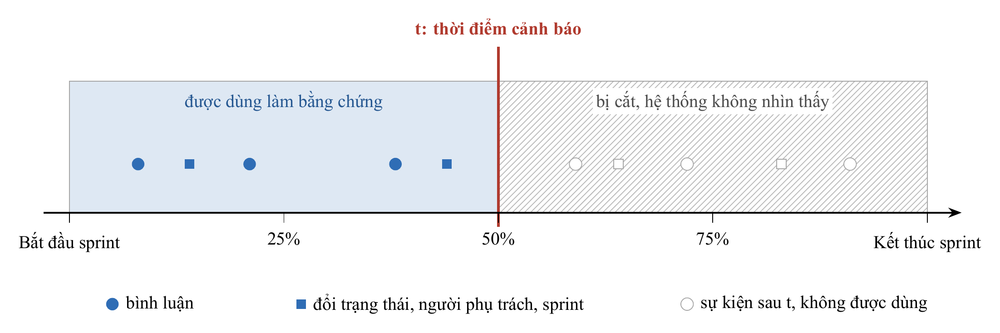

# TÓM TẮT

Báo cáo này trình bày kết quả thực hiện Nội dung 1 trong đề cương đăng ký đề tài mã số `04-SV-2026-RIPT`: tổng quan các công trình nghiên cứu liên quan, xác định khoảng trống thực nghiệm và chốt hướng tiếp cận của đề tài. So với đề cương ban đầu (tháng 5/2026) vốn dự kiến dùng LLM và suy luận dựa trên trường hợp tương tự (case-based reasoning) để ước lượng thời gian thực hiện của từng công việc cùng kiến trúc đa agent tự động can thiệp, quá trình khảo sát tài liệu và thực nghiệm kiểm chứng đã dẫn tới bốn điều chỉnh quan trọng. Thứ nhất, bài toán phát hiện sớm nguy cơ trễ hạn trong sprint được đặt vào khung lý thuyết giám sát quy trình dự đoán và đề xuất (predictive và prescriptive process monitoring) [3, 8], kết hợp quy tắc cắt dữ liệu tại mốc $t$ để loại bỏ lỗi rò rỉ thời gian trên dữ liệu lịch sử issue [6, 9]. Thứ hai, đối với hướng ước lượng công sức (story point) từ mô tả văn bản và từ các issue tương tự trước đó, nghiên cứu tái lập Deep-SE [7] cùng thực nghiệm kiểm chứng E6 của chúng tôi trên 5 dự án TAWOS ($\text{MAE} = 1,61$ so với $1,71$ của trung vị dự án, khoảng tin cậy 95% $[-0,24; +0,01]$ chứa giá trị 0) cho thấy cách tiếp cận này không phân biệt được với mức trung vị; vì vậy chúng tôi chuyển sang ước lượng số không xong dự kiến ở cấp toàn sprint dựa trên tỉ lệ lịch sử. Thứ ba, quyết định thời điểm và đối tượng cảnh báo được tách khỏi LLM và giao cho mô hình CatBoost [5] dưới ràng buộc ngân sách $K = \lceil 0,2n \rceil$ [4]. Thứ tư, để chống tấn công tiêm lệnh gián tiếp từ dữ liệu người dùng [1, 2], LLM không được cấp quyền ghi dữ liệu mà đặt giữa bộ thu thập SQL cố định và bước kiểm tra bằng code (verifier), đồng thời mọi hành động trên Plane đều do con người duyệt.

Từ khóa: tổng quan tài liệu, giám sát quy trình dự đoán, rò rỉ thời gian, ước lượng công sức Agile, agent chủ động, tiêm lệnh gián tiếp.

# CHƯƠNG 1. ĐỐI CHIẾU VỚI ĐỀ CƯƠNG GỐC VÀ CÁC QUYẾT ĐỊNH ĐIỀU CHỈNH

Trong mục 11 của đề cương đăng ký đề tài (tháng 5/2026), Nội dung 1 được giao nhiệm vụ: "Tổng quan tài liệu: nghiên cứu các công trình liên quan về AI trong quản lý dự án, agentic AI, LLM-based effort estimation, case-based reasoning" với kết quả cần đạt là "Bản tổng quan tài liệu, xác định khoảng trống nghiên cứu và hướng tiếp cận của đề tài". Khi đối chiếu các giả định ban đầu với kết quả khảo sát học thuật và kiểm chứng thực nghiệm trên bộ dữ liệu TAWOS [6], chúng tôi đã điều chỉnh hướng tiếp cận của đề tài. Bảng 1.1 tổng hợp các thay đổi và lý do kỹ thuật tương ứng.

Bảng 1.1. Đối chiếu định hướng trong đề cương gốc và quyết định điều chỉnh ở Nội dung 1

| Hạng mục trong đề cương gốc (05/2026) | Nội dung dự kiến ban đầu | Quyết định điều chỉnh trong nghiên cứu hiện tại | Lý do và bằng chứng thực nghiệm |
|---|---|---|---|
| Cơ sở lý thuyết cho bài toán dự báo trễ hạn | Theo dõi tiến độ chung và dự báo khả năng trễ deadline từ trạng thái hiện tại | Đặt bài toán vào khung giám sát quy trình dự đoán định hướng kết quả [8] và giám sát quy trình đề xuất [3] trên dữ liệu cặp issue-sprint cắt tại mốc $t$ | Dữ liệu bảng `issue` trong Jira và TAWOS lưu giá trị cuối cùng sau khi đóng issue [6, 9]; nếu không tái dựng trạng thái tại mốc $t$ từ `change_log` sẽ dẫn đến rò rỉ thông tin tương lai |
| Ước lượng công sức bằng LLM và suy luận theo trường hợp tương tự (LLM-based effort estimation, case-based reasoning) | Dùng LLM và truy xuất các công việc tương tự trong quá khứ để ước lượng effort và thời gian hoàn thành của từng issue | Loại bỏ ước lượng story point và ngày hoàn thành của từng issue riêng lẻ; chuyển sang tính số không xong dự kiến ở cấp sprint từ tỉ lệ lịch sử của dự án | Nghiên cứu tái lập Deep-SE [7] chỉ ra mô hình học sâu hiếm khi vượt trung vị. Thực nghiệm E6 của chúng tôi (lấy 20 issue tương tự nhất bằng kNN trên 5 dự án TAWOS) cho $\text{MAE} = 1,61$ so với $1,71$ của trung vị, CI 95% $[-0,24; +0,01]$ chứa 0 |
| Kiến trúc Agentic AI và đa agent (Multi-agent) | Các agent phối hợp với nhau để thảo luận ước lượng, tự động phát hiện rủi ro và tự động can thiệp | Bỏ kiến trúc đa agent; tách bộ điều khiển phát hiện (CatBoost [5] + ngân sách $K = \lceil 0,2n \rceil$) khỏi LLM [4]; chỉ gọi LLM một lượt cho các cảnh báo đã chọn | Gọi LLM liên tục để quyết định khi nào báo gây tốn chi phí và kém ổn định [4]; bộ điều khiển học máy trên đặc trưng bảng có thể kiểm định định lượng và tái lập |
| Cơ chế kiểm soát đầu ra và an toàn của Agent | Agent tự động can thiệp và ghi nhận qua công cụ quan sát bên ngoài (Opik) | Đặt LLM giữa bộ thu thập SQL chỉ đọc và bước hậu kiểm bằng code (verifier); bọc văn bản người dùng trong thẻ `<untrusted>`; con người duyệt mọi thao tác ghi trên Plane | Bình luận và mô tả issue là dữ liệu do người dùng nhập nên có nguy cơ chứa lệnh tiêm nhiễm gián tiếp [1, 2]; chỉ dặn trong prompt không đủ ngăn hành vi sai lệch |

# CHƯƠNG 2. TỔNG QUAN CÁC CÔNG TRÌNH NGHIÊN CỨU LIÊN QUAN

Chúng tôi tổng hợp tài liệu theo bốn nhóm quyết định thiết kế của hệ thống: giám sát quy trình dự đoán trên dữ liệu lịch sử issue, cơ chế kích hoạt agent chủ động dưới ngân sách giới hạn, an toàn khi kết hợp LLM với công cụ trên dữ liệu người dùng, và bài toán ước lượng công sức trong dự án Agile.

## 2.1. Giám sát quy trình dự đoán và bài toán rò rỉ thời gian trên dữ liệu issue

Dự báo một issue đang thực hiện có kịp hoàn thành trước ngày kết thúc sprint hay không thuộc lĩnh vực giám sát quy trình dự đoán (Predictive Process Monitoring), một hướng nghiên cứu kết hợp khai phá quy trình (Process Mining) và quản trị quy trình nghiệp vụ (Business Process Management - BPM). Hướng tiếp cận này trích xuất chuỗi sự kiện lịch sử và sự kiện thời gian thực từ nhật ký hệ thống (event logs), sau đó dùng mô hình học máy để dự đoán kết quả tương lai của một quy trình đang chạy. Trong nghiên cứu tổng quan và đối sánh chuẩn về giám sát quy trình dự đoán định hướng kết quả [8], mỗi lượt thực thi quy trình được biểu diễn như một chuỗi sự kiện gắn dấu thời gian; tại thời điểm đánh giá, mô hình chỉ quan sát phần tiến độ công việc đã diễn ra trước đó để dự đoán nhãn kết quả nhị phân ở cuối quy trình. Đặt vào bài toán quản lý sprint trong Scrum, mỗi cặp issue-sprint tương ứng với một lượt thực thi quy trình, các bản ghi thay đổi trạng thái, người phụ trách hoặc bình luận xảy ra trước mốc $t$ là phần tiến độ đã diễn ra, còn nhãn cần dự báo là issue có đạt trạng thái hoàn thành khi sprint kết thúc hay không.

Khi chuyển từ việc chấm điểm rủi ro sang gợi ý hành động xử lý, bài toán mở rộng sang giám sát quy trình theo hướng đề xuất (prescriptive process monitoring). Khảo sát tổng quan của nhánh nghiên cứu này [3] phân tích các phương pháp theo mục tiêu can thiệp, loại hành động đề xuất và chính sách kích hoạt, đồng thời chỉ ra hai thực tế: nguồn lực can thiệp của con người trong mỗi chu kỳ làm việc luôn có giới hạn, và đa số công trình mới dừng ở mô phỏng ngoại tuyến chứ chưa gắn với quy trình phê duyệt trực tiếp trên phần mềm quản lý công việc.

Để nghiên cứu thực nghiệm hướng tiếp cận này trên dữ liệu phần mềm thực tế, bộ dữ liệu TAWOS [6] cung cấp lịch sử hoạt động Jira của 44 dự án mã nguồn mở (bản 1.1 nạp vào PostgreSQL của đề tài gồm 39 dự án, 4.594 sprint, 458.232 issue và 9.253.419 bản ghi thay đổi), bao gồm bảng nhật ký thay đổi (`change_log`), bình luận (`comment`) và liên kết phụ thuộc giữa các issue (`issue_link`). Tuy nhiên, nghiên cứu thực nghiệm về sai lệch thời gian khi khai thác dữ liệu quản lý issue [9] cảnh báo một lỗi phương pháp phổ biến: các cột thuộc tính trên bảng `issue` (như trạng thái, mức ưu tiên, người phụ trách, mã sprint) lưu giá trị cuối cùng tại thời điểm trích xuất bộ dữ liệu, tức sau khi nhiều issue đã đóng. Nếu mô hình dự báo hoặc agent đọc trực tiếp các cột này tại một mốc $t$ trong quá khứ, hệ thống sẽ vô tình sử dụng thông tin tương lai và tạo ra kết quả chính xác giả tạo. Từ cảnh báo này, chúng tôi thiết lập quy tắc cắt tại mốc $t$ làm yêu cầu bắt buộc cho toàn bộ đề tài (minh họa ở hình 2.1): mọi đặc trưng của mô hình dự báo và mọi sự kiện cung cấp cho LLM đều phải được tái dựng từ bảng `change_log` với dấu thời gian không vượt quá $t$.

Hình 2.1. Quy tắc cắt dữ liệu tại mốc t (minh họa ở mốc 50% thời lượng sprint): chỉ các sự kiện xảy ra trước hoặc tại mốc t được phép đi vào mô hình dự báo và bộ thu thập bằng chứng

## 2.2. Agent chủ động và cơ chế quyết định thời điểm cảnh báo

Trong đề cương ban đầu, chúng tôi dự kiến dùng một hệ thống agent dựa trên LLM để vừa theo dõi tiến độ liên tục, vừa tự quyết định khi nào cần phát cảnh báo. Tuy nhiên, nghiên cứu về thiết kế agent chủ động [4] chỉ ra rằng bài toán hỗ trợ chủ động gồm hai quyết định tách biệt: quyết định "khi nào cần lên tiếng" và quyết định "nói nội dung gì". Nếu giao cả quyết định "khi nào cần báo" cho LLM, hệ thống phải gọi mô hình ngôn ngữ lặp đi lặp lại ở mọi điểm kiểm tra ngay cả khi công việc đang diễn ra bình thường, dẫn đến chi phí cao và độ nhạy cảnh báo dao động theo prompt. Thiết kế ổn định hơn là sử dụng một bộ điều khiển nhỏ, tất định để chọn thời điểm và đối tượng cần báo, sau đó chỉ gọi LLM để giải thích và soạn nội dung cho các trường hợp đã được chọn [4].

Chúng tôi áp dụng nguyên tắc phân tách này vào kiến trúc của đề tài. Việc chấm điểm nguy cơ trễ hạn ở các mốc $t$ bằng 0%, 25%, 50% và 75% thời lượng sprint được giao cho mô hình gradient boosting trên cây quyết định CatBoost [5] vì thuật toán này xử lý trực tiếp các đặc trưng phân loại và bảng dữ liệu vừa phải mà không bị lệch mục tiêu khi mã hóa biến phân loại. Tại mỗi sprint có $n$ issue đang mở và đủ điều kiện xét duyệt, bộ điều khiển chọn tối đa $K$ cảnh báo theo công thức ngân sách:

$$K = \lceil 0,2n \rceil$$

Cách giới hạn theo ngân sách cố định sát với khả năng rà soát của người quản lý hơn so với một ngưỡng xác suất tuyệt đối, đồng thời tránh hiện tượng một ngưỡng xác suất cố định sinh quá nhiều cảnh báo ở dự án này nhưng không sinh cảnh báo nào ở dự án khác. Khi đánh giá chất lượng cảnh báo dưới ngân sách $K$, độ chính xác ($\sub{Precision}{K}$) phải được đối chiếu với tỉ lệ không hoàn thành nền ($\pi$) của tập issue còn mở thông qua chỉ số $\sub{Lift}{K} = \frac{\sub{Precision}{K}}{\pi}$, bởi vào nửa sau của sprint khi các issue dễ đã hoàn thành trước, tỉ lệ nền $\pi$ tự nhiên tăng cao.

## 2.3. Giải thích có bằng chứng và an toàn trước tấn công tiêm lệnh gián tiếp

Một điểm số rủi ro từ mô hình CatBoost chưa cho trưởng nhóm biết nguyên nhân cụ thể khiến issue có nguy cơ trễ. LLM phù hợp để tổng hợp nguyên nhân từ thảo luận và lịch sử thay đổi, nhưng đi kèm hai rủi ro kỹ thuật: mô hình có thể tự suy diễn sự kiện không có thật, và mô hình có thể bị thao túng bởi chính văn bản bên trong issue.

Nghiên cứu về bảo mật ứng dụng tích hợp LLM [2] định nghĩa rủi ro thứ hai là tấn công tiêm lệnh gián tiếp (indirect prompt injection): khi ứng dụng đọc dữ liệu văn bản do người dùng bên ngoài nhập vào (chẳng hạn tiêu đề, mô tả hoặc bình luận của issue), kẻ tấn công có thể cài các câu lệnh điều khiển vào dữ liệu đó để chiếm quyền điều hướng mô hình. Bộ chuẩn đánh giá AgentDojo [1] thử nghiệm các kịch bản tiêm lệnh nằm trong kết quả trả về của công cụ và chứng minh rằng việc chỉ thêm câu nhắc phòng vệ trong prompt hệ thống không đủ để ngăn chặn hoàn toàn các hành vi gọi công cụ trái phép. Chuẩn đánh giá tương tác công cụ $\tau$-bench [10] cũng nhấn mạnh việc đánh giá agent thông qua trạng thái thay đổi thực tế của cơ sở dữ liệu cuối luồng chạy và tính nhất quán qua nhiều lần gọi.

Từ các kết quả trên, chúng tôi loại bỏ cơ chế "agent tự động can thiệp" trong đề cương gốc và thay bằng kiến trúc kiểm soát bằng code ở cả đầu vào lẫn đầu ra của LLM:
1. LLM không có công cụ ghi dữ liệu; mọi văn bản do người dùng viết được đặt trong cặp thẻ `<untrusted>`.
2. Dữ liệu đầu vào cho bước chẩn đoán chỉ lấy từ năm truy vấn SQL cố định (bộ thu thập), mỗi bản ghi gắn một mã sự kiện (`event_id`).
3. Đầu ra JSON của LLM phải chọn nguyên nhân trong một tập đóng 6 nhãn và đi qua bước hậu kiểm bằng code (verifier): mọi giả thuyết trích dẫn mã sự kiện không tồn tại hoặc sai loại sự kiện đều bị loại bỏ trước khi lưu.
4. Mọi thao tác thay đổi dữ liệu trên nền tảng Plane (nâng mức ưu tiên, đăng lời nhắc, chuyển sang sprint kế tiếp) chỉ được thực thi khi người quản lý bấm nút Duyệt và đều lưu trạng thái gốc để Hoàn tác.

## 2.4. Ước lượng công sức Agile và bằng chứng thực nghiệm dừng hướng ước lượng cấp issue

Trong đề cương gốc, một nội dung trọng tâm là dùng LLM kết hợp suy luận dựa trên trường hợp tương tự (case-based reasoning) để ước lượng công sức (effort / story point) cho từng công việc nhằm phát hiện kế hoạch không khả thi. Tuy nhiên, nghiên cứu tái lập độc lập về ước lượng story point bằng học sâu (Deep-SE) trên bộ dữ liệu TAWOS [7] cho thấy các mô hình biểu diễn văn bản học sâu chỉ vượt qua phép đoán theo trung vị lịch sử ở một số ít dự án, và độ tương đồng văn bản mô tả issue không đủ thông tin để dự đoán chính xác công sức thực hiện.

Để kiểm tra trực tiếp giả thuyết suy luận dựa trên trường hợp tương tự trước khi đầu tư xây dựng mô-đun sản phẩm, chúng tôi đã thực hiện thực nghiệm E6 trên 5 dự án thuộc TAWOS: với mỗi issue mới, thuật toán tìm $k = 20$ issue đã hoàn thành trước thời điểm đó trong cùng dự án có đặc trưng gần nhất (kNN) để ước lượng story point, rồi so sánh với mức tham chiếu đơn giản là lấy trung vị story point của các issue đã xong trước đó trong cùng dự án. Quy tắc kết luận được khóa trước khi chạy yêu cầu phương pháp kNN phải có sai số tuyệt đối trung bình ($\text{MAE}$) thấp hơn trung vị có ý nghĩa thống kê. Kết quả thực nghiệm E6 được tóm tắt tại bảng 2.1.

Bảng 2.1. Kết quả thực nghiệm kiểm chứng E6 về ước lượng story point từ 20 issue tương tự nhất trên 5 dự án TAWOS

| Phương pháp ước lượng | Sai số tuyệt đối trung bình ($\text{MAE}$) | Hiệu số so với trung vị dự án [CI 95%] | Kết luận theo quy tắc khóa trước |
|---|---|---|---|
| Trung vị lịch sử của cùng dự án (mức tham chiếu) | 1,71 story point | - | Mức cơ sở |
| Truy xuất 20 issue tương tự nhất trong quá khứ (kNN, $k=20$) | 1,61 story point | -0,10 [-0,24; +0,01] | Không vượt mức tham chiếu có ý nghĩa thống kê (khoảng tin cậy chứa 0) |

Vì khoảng tin cậy 95% của hiệu số $\text{MAE}$ chứa giá trị 0, phương pháp suy luận từ các issue tương tự không chứng minh được lợi thế so với phép lấy trung vị đơn giản. Cùng với kết quả của nghiên cứu tái lập [7], bằng chứng thực nghiệm này cho thấy việc ước lượng story point hay ngày hoàn thành cho từng issue riêng lẻ có độ nhiễu quá lớn để làm căn cứ điều phối sprint. Do đó, chúng tôi quyết định dừng hướng ước lượng cấp issue và chuyển sang bài toán lập kế hoạch ở cấp toàn sprint: ước lượng số không xong dự kiến $b$ của sprint hiện tại từ tỉ lệ issue còn mở không kịp hoàn thành ở các sprint trước của cùng dự án.

# CHƯƠNG 3. KHOẢNG TRỐNG NGHIÊN CỨU VÀ ĐỊNH VỊ ĐỀ TÀI

Bảng 3.1 đối chiếu các hướng nghiên cứu đã khảo sát với phạm vi và cơ chế của đề tài sau khi điều chỉnh.

Bảng 3.1. Đối chiếu các hướng nghiên cứu liên quan và vị trí của đề tài

| Hướng nghiên cứu | Nội dung đã giải quyết trong tài liệu | Điểm còn bỏ ngỏ đối với bài toán quản lý sprint | Cách tiếp cận của đề tài (Mã đề tài 04-SV-2026-RIPT) |
|---|---|---|---|
| Giám sát quy trình dự đoán và đề xuất [3, 8] | Dự đoán kết quả cuối cùng từ chuỗi sự kiện đã diễn ra; mô hình hóa bài toán chọn thời điểm can thiệp khi nguồn lực hữu hạn | Thường dừng ở điểm số xác suất hoặc mô phỏng ngoại tuyến; thiếu bước giải thích nguyên nhân gắn với sự kiện cụ thể trên công cụ quản lý dự án | Kết hợp mô hình CatBoost động dưới ngân sách $K = \lceil 0,2n \rceil$ với khối chẩn đoán trích dẫn mã sự kiện lịch sử và cơ chế Duyệt / Hoàn tác trên Plane |
| Khai thác dữ liệu lịch sử hệ thống quản lý issue [6, 9] | Cung cấp bộ dữ liệu TAWOS [6] và chỉ ra lỗi rò rỉ thời gian khi đọc trực tiếp trạng thái cuối cùng trên bảng `issue` [9] | Nhiều công trình dự báo trong kỹ nghệ phần mềm vẫn dùng thuộc tính tĩnh cuối kỳ hoặc không kiểm tra chéo bước tái dựng trạng thái | Tái dựng toàn bộ trạng thái và sự kiện tại mốc $t$ từ bảng `change_log`; kiểm tra chéo nhãn trên 765 cặp mẫu bằng SQL độc lập và kiểm thử tự động |
| Agent chủ động dùng công cụ và bảo mật LLM [1, 2, 4, 10] | Tách bộ điều khiển kích hoạt khỏi LLM [4]; chỉ ra nguy cơ tiêm lệnh gián tiếp từ dữ liệu công cụ [1, 2] và chuẩn đánh giá trạng thái cuối [10] | Ít công trình áp dụng đồng thời bộ điều khiển học máy, bộ thu thập chỉ đọc và bước hậu kiểm mã sự kiện cho bài toán rủi ro sprint | Đặt LLM giữa 5 truy vấn SQL cắt tại mốc $t$ và bước kiểm tra `verifier`; bọc `<untrusted>`, chặn bịa mã issue và giữ nguyên tắc AI không có quyền ghi |
| Ước lượng công sức trong dự án Agile [7] | Chứng minh ước lượng story point từng issue bằng học sâu khó vượt trung vị lịch sử của dự án | Người quản lý vẫn cần biết sprint hiện tại đang vượt sức chứa bao nhiêu công việc để cắt giảm phạm vi kịp thời | Không ước lượng story point từng issue; tính số không xong dự kiến ở cấp sprint từ tỉ lệ lịch sử và đề xuất tập chuyển đóng bắc cầu theo quan hệ chờ-nhau |

Qua quá trình khảo sát tài liệu và thực nghiệm kiểm chứng ở Nội dung 1, bài toán và hướng tiếp cận cuối cùng của đề tài được xác lập gồm bốn bước nối tiếp nhau trên nền tảng quản lý dự án Plane:
1. Phát hiện sớm các issue có nguy cơ không kịp hoàn thành trong sprint tại mốc $t$ bằng mô hình CatBoost động dưới ngân sách $K = \lceil 0,2n \rceil$ cảnh báo mỗi sprint (RQ1).
2. Chẩn đoán nguyên nhân trễ hạn của từng cảnh báo bằng một lượt gọi LLM trên tập sự kiện lịch sử đã cắt tại mốc $t$, đi qua bước kiểm tra bằng code (verifier) và đối chiếu với bộ nhãn của người chấm độc lập (RQ2).
3. Ước lượng số không xong dự kiến ở cấp sprint bằng công thức thống kê lịch sử, chọn tập chuyển có đóng bắc cầu theo chuỗi chặn và cho phép người quản lý duyệt hoặc hoàn tác theo lô (RQ3).
4. Cung cấp agent hỏi đáp chỉ đọc sử dụng 5 công cụ định kiểu chặt có lọc quyền xem theo dự án để người quản lý tra cứu tình hình rủi ro bằng ngôn ngữ tự nhiên (RQ4).

# TÀI LIỆU THAM KHẢO

1. E. Debenedetti, J. Zhang, M. Balunović, L. Beurer-Kellner, M. Fischer, F. Tramèr, "AgentDojo: A Dynamic Environment to Evaluate Prompt Injection Attacks and Defenses for LLM Agents," NeurIPS 2024 Datasets and Benchmarks Track. arXiv:2406.13352.
2. K. Greshake, S. Abdelnabi, S. Mishra, C. Endres, T. Holz, M. Fritz, "Not what you've signed up for: Compromising Real-World LLM-Integrated Applications with Indirect Prompt Injection," 2023. arXiv:2302.12173.
3. K. Kubrak, F. Milani, A. Nolte, M. Dumas, "Prescriptive Process Monitoring: Quo Vadis?," PeerJ Computer Science, 2022. arXiv:2112.01769.
4. X. Liu, R. Zhang, A. H. Abdi, M. Galley, Z. Chen, S. Xiong, X. Wang, J. Gao, "Do Proactive Agents Need an LLM to Decide When to Act?," preprint, 2026. arXiv:2605.30152.
5. L. Prokhorenkova, G. Gusev, A. Vorobev, A. V. Dorogush, A. Gulin, "CatBoost: unbiased boosting with categorical features," NeurIPS 2018. arXiv:1706.09516.
6. V. Tawosi, A. Al-Subaihin, R. Moussa, F. Sarro, "A Versatile Dataset of Agile Open Source Software Projects," MSR 2022. arXiv:2202.00979.
7. V. Tawosi, R. Moussa, F. Sarro, "Agile Effort Estimation: Have We Solved the Problem Yet? Insights From A Replication Study," IEEE Transactions on Software Engineering, 2022. arXiv:2201.05401.
8. I. Teinemaa, M. Dumas, M. La Rosa, F. M. Maggi, "Outcome-Oriented Predictive Process Monitoring: Review and Benchmark," ACM Transactions on Knowledge Discovery from Data, 13(2), 2019. arXiv:1707.06766.
9. F. Tu, J. Zhu, Q. Zheng, M. Zhou, "Be Careful of When: An Empirical Study on Time-Related Misuse of Issue Tracking Data," ESEC/FSE 2018. doi:10.1145/3236024.3236054.
10. S. Yao, N. Shinn, P. Razavi, K. Narasimhan, "τ-bench: A Benchmark for Tool-Agent-User Interaction in Real-World Domains," 2024. arXiv:2406.12045.
