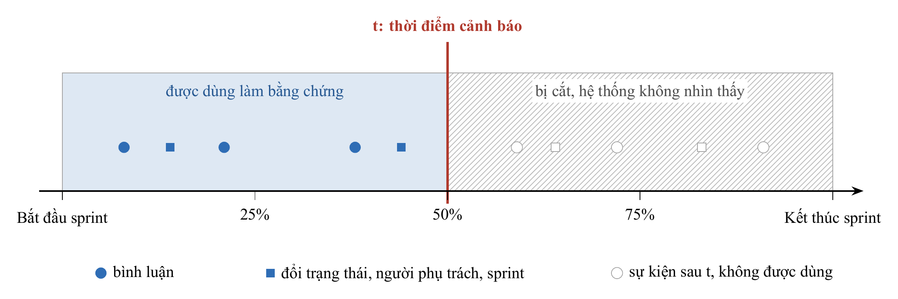
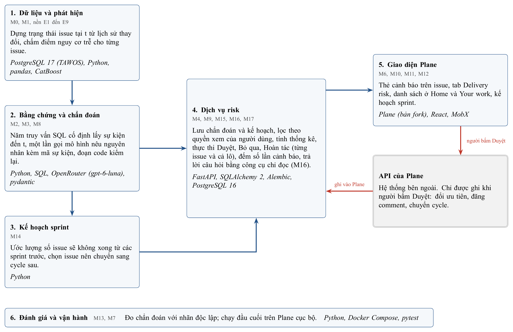

# TÓM TẮT

Báo cáo này trình bày kết quả thực hiện Nội dung 2 trong đề cương đăng ký đề tài mã số `04-SV-2026-RIPT`: phân tích yêu cầu, đề xuất mô hình hệ thống, thiết kế kiến trúc agent và thiết kế cơ sở dữ liệu. Thay vì xây dựng lại từ đầu các bảng quản lý tác vụ cơ bản (`Task`, `Phase`, `WorkSchedule`, `TimeLog`) như dự kiến trong đề cương tháng 5/2026, chúng tôi tích hợp hệ thống trực tiếp vào nền tảng quản lý dự án mã nguồn mở Plane và tách kiến trúc thành sáu khối chức năng vận hành trên hai cơ sở dữ liệu PostgreSQL riêng biệt: cơ sở dữ liệu nghiên cứu lưu lịch sử TAWOS [6] (tái dựng trạng thái tại mốc $t$ từ bảng `change_log` để chống rò rỉ thời gian [9]) và cơ sở dữ liệu dịch vụ risk lưu cảnh báo, kế hoạch cấp sprint cùng nhật ký quyết định của người dùng. Toàn bộ thiết kế tuân thủ bảy bất biến an toàn được kiểm tra bằng code: cắt dữ liệu tại mốc $t$, mọi giả thuyết phải trỏ tới mã sự kiện có thật qua bước kiểm tra verifier, LLM không có quyền ghi dữ liệu, văn bản do người dùng viết được bọc trong khối `<untrusted>`, lọc dữ liệu theo quyền xem dự án trên Plane, các chỉ số định lượng do thuật toán tính và mọi thao tác ghi dữ liệu đều đi qua tập hành động đóng khi người dùng bấm Duyệt.

Từ khóa: phân tích yêu cầu, kiến trúc hệ thống, bất biến an toàn, thiết kế cơ sở dữ liệu, luồng hoạt động agent, Plane.

# CHƯƠNG 1. ĐỐI CHIẾU VỚI ĐỀ CƯƠNG GỐC VÀ CÁC QUYẾT ĐỊNH ĐIỀU CHỈNH

Trong mục 11 của đề cương đăng ký đề tài (tháng 5/2026), Nội dung 2 gồm các công việc: "Phân tích yêu cầu, đề xuất mô hình hệ thống, thiết kế kiến trúc agent và cơ sở dữ liệu" với sản phẩm đầu ra là "Tài liệu đặc tả yêu cầu, sơ đồ kiến trúc hệ thống, schema database, thiết kế luồng hoạt động của agent". Bảng 1.1 tóm tắt những thay đổi về mặt kiến trúc và thiết kế dữ liệu so với đề cương gốc.

Bảng 1.1. Đối chiếu thiết kế dự kiến trong đề cương gốc và thiết kế thực tế ở Nội dung 2

| Hạng mục trong đề cương gốc (05/2026) | Thiết kế dự kiến ban đầu | Quyết định thiết kế trong nghiên cứu hiện tại | Lý do kỹ thuật |
|---|---|---|---|
| Mô hình ứng dụng quản lý công việc | Tự thiết kế một ứng dụng web quản lý công việc riêng từ đầu | Tích hợp dịch vụ risk (`agentick-backend`) với nền tảng quản lý dự án mã nguồn mở Plane (trong Plane, một sprint được gọi là một cycle) | Tận dụng đầy đủ hệ thống phân quyền dự án, quản lý sprint/issue sẵn có của Plane; tập trung thiết kế vào phần phát hiện, chẩn đoán và điều phối rủi ro |
| Lược đồ cơ sở dữ liệu (Database schema) | Các bảng `Task`, `Phase`, `Project`, `WorkSchedule`, `TimeLog` trong một cơ sở dữ liệu chung | Tách thành hai cơ sở dữ liệu PostgreSQL: PostgreSQL 17 lưu 39 dự án TAWOS (`tawos_raw`) tái dựng trạng thái tại mốc $t$ từ `change_log`; PostgreSQL 16 lưu 4 bảng nghiệp vụ rủi ro (`alerts`, `alert_decisions`, `plans`, `plan_decisions`) | Giữ nguyên vẹn dữ liệu nguồn TAWOS để kiểm toán độc lập; tách riêng dữ liệu cảnh báo và nhật ký phê duyệt của dịch vụ risk khỏi cơ sở dữ liệu nội bộ của Plane |
| Kiến trúc và quyền hạn của AI Agent | Agent tự động theo dõi thời gian thực và tự động thực thi can thiệp; giám sát qua Opik | Kiến trúc 6 khối tuân thủ 7 bất biến an toàn: LLM chỉ đọc sự kiện từ 5 truy vấn SQL cố định hoặc 5 công cụ tra cứu định kiểu chặt; kiểm tra đầu ra bằng Pydantic và verifier; không dùng framework agent hay text-to-SQL | Chống rò rỉ dữ liệu chéo dự án và tấn công tiêm lệnh gián tiếp [1, 2]; chỉ có một đường ghi dữ liệu duy nhất sang API của Plane khi người dùng bấm nút Duyệt |

# CHƯƠNG 2. ĐẶC TẢ YÊU CẦU VÀ QUY TẮC DỮ LIỆU

## 2.1. Định nghĩa hình thức của bài toán

Đơn vị phân tích của hệ thống là một cặp issue-sprint: một issue xuất hiện trong hai sprint liên tiếp được tính là hai cặp độc lập. Mỗi sprint có thời điểm bắt đầu và thời điểm kết thúc; mốc đánh giá $t$ được tính theo phần trăm thời lượng sprint đã trôi qua, nhận bốn giá trị 0%, 25%, 50% và 75%. Tập cam kết đầu sprint gồm các issue thuộc sprint tại thời điểm bắt đầu. Một cặp issue-sprint nhận nhãn "không xong" ($y = 1$) nếu tại ngày kết thúc sprint, trạng thái của issue không thuộc nhóm trạng thái hoàn thành (`done`, `resolved`, `closed`, `complete`).

Tại mốc $t$, khối phát hiện chấm điểm rủi ro $p(t) \in [0, 1]$ cho từng issue còn đang mở và chưa bị hủy (`invalid`, `won't fix`). Trong một sprint có $n$ issue đủ điều kiện xét duyệt tại mốc $t$, hệ thống chọn tối đa $K$ cảnh báo có điểm $p(t)$ cao nhất theo ngân sách:

$$K = \lceil 0,2n \rceil$$

Với mỗi cảnh báo, hệ thống trích xuất tập sự kiện lịch sử $E(t)$ có dấu thời gian không vượt quá $t$, chẩn đoán tối đa 3 giả thuyết nguyên nhân trong tập đóng 6 nhãn kèm mã sự kiện làm bằng chứng, và đề xuất 1 hành động trong tập đóng 3 thao tác (`raise_priority`, `nudge_owner`, `move_next_cycle`). Ở cấp toàn sprint, hệ thống ước lượng số không xong dự kiến $b$ từ tỉ lệ lịch sử của dự án và đề xuất tập chuyển sang sprint kế tiếp.

## 2.2. Bảy bất biến an toàn của hệ thống

Thay vì đặt các yêu cầu phi chức năng rời rạc, chúng tôi thiết kế hệ thống xoay quanh bảy bất biến an toàn trong bảng 2.1. Mọi thành phần từ truy vấn dữ liệu, lời gọi LLM đến giao diện người dùng đều bị ràng buộc bởi bảy bất biến này và có bài kiểm thử tự động kiểm tra.

Bảng 2.1. Bảy bất biến an toàn trong thiết kế hệ thống

| Bất biến | Quy tắc ràng buộc | Thành phần cưỡng chế trong mã nguồn |
|---|---|---|
| 1. Cắt tại mốc $t$ | Mọi đặc trưng dự báo và sự kiện chẩn đoán chỉ lấy bản ghi có dấu thời gian không muộn hơn $t$; trạng thái tại $t$ được tái dựng từ bảng `change_log` | Bộ thu thập SQL (`collectors.py`), bài kiểm thử `test_collectors.py` |
| 2. Bám bằng chứng | Mỗi giả thuyết nguyên nhân trên thẻ cảnh báo phải dẫn chiếu tới mã sự kiện có thật trong $E(t)$ và đúng loại sự kiện quy định | Bước hậu kiểm `verifier` (`diagnosis.py`), bài kiểm thử `test_diagnosis.py` |
| 3. LLM không có quyền ghi | Mô hình ngôn ngữ không có công cụ ghi dữ liệu; dữ liệu trên Plane chỉ thay đổi khi người dùng bấm Duyệt | Dịch vụ backend (`routers/alerts.py`, `routers/plans.py`), lược đồ Pydantic |
| 4. Văn bản người dùng là dữ liệu | Tiêu đề và bình luận của issue được bọc trong cặp thẻ `<untrusted>`, cắt giới hạn độ dài, xóa chuỗi thoát thẻ trước khi đưa vào prompt | Khối chẩn đoán và agent hỏi đáp (`assistant.py`) |
| 5. Tôn trọng quyền xem | Sự kiện nhắc tới issue của dự án khác chỉ hiển thị tiêu đề nếu người đang xem có quyền truy cập dự án đó trên Plane; thống kê và công cụ hỏi đáp lọc theo danh sách dự án được phép xem | Dịch vụ backend và 5 công cụ của agent hỏi đáp (`test_alerts_api.py`, `test_assistant_api.py`) |
| 6. Số liệu định lượng do code tính | Điểm rủi ro $p(t)$, số không xong dự kiến $b$ và danh sách tập chuyển đều do thuật toán tính toán; LLM không sinh con số thống kê | Khối phát hiện CatBoost và khối lập kế hoạch sprint (`sprint_plan.py`) |
| 7. Xử lý theo lô qua hành động đóng | Phê duyệt theo lô thực thi từng dòng qua đúng hàm hành động đóng và lưu giá trị gốc để hoàn tác độc lập từng dòng | Khối duyệt kế hoạch (`routers/plans.py`, `test_plans_api.py`) |

## 2.3. Nguồn dữ liệu và quy tắc cắt tại mốc t

Cơ sở dữ liệu nghiên cứu sử dụng bản TAWOS 1.1 [6] nạp vào PostgreSQL 17 (schema `tawos_raw`), gồm 39 dự án, 4.594 sprint, 458.232 issue và 9.253.419 dòng nhật ký thay đổi. Bảng 2.2 trình bày quy mô dữ liệu qua từng bước lọc đến tập đánh giá chính thức.

Bảng 2.2. Quy mô dữ liệu qua các bước lọc từ TAWOS 1.1

| Bước xử lý dữ liệu | Số lượng bản ghi |
|---|---|
| Cặp issue-sprint xác định được thành viên sprint | 28.746 cặp |
| Cặp issue-sprint gán được nhãn hoàn thành / không hoàn thành rõ ràng | 22.147 cặp (77,04%) |
| Tổng số điểm cắt thời gian (nhân 4 mốc 0%, 25%, 50%, 75%) | 88.588 bản ghi |
| Tập đánh giá sau khi lọc các dự án có từ 50 sprint, 200 cặp và 30 cặp mỗi lớp | 14 dự án, 1.962 sprint, 18.322 cặp |

Do các cột `status`, `priority`, `assignee_id` và `sprint_id` trên bảng `issue` của TAWOS lưu giá trị cuối cùng sau khi đóng issue [6, 9], hàm tái dựng trạng thái tại mốc $t$ truy vấn bảng `change_log`, chuẩn hóa tên trường về chữ thường (`lower(field)`) và lấy giá trị cập nhật muộn nhất không vượt quá $t$ (hình 2.1). Để phục vụ triển khai giao diện và đo đạc chẩn đoán, dự án IS (Indy SDK của Hyperledger) trong TAWOS được nhập sang nền tảng Plane dưới mã dự án ISP.

Hình 2.1. Quy tắc cắt tại mốc t áp dụng thống nhất cho cả mô hình dự báo CatBoost và bộ thu thập sự kiện của agent chẩn đoán

# CHƯƠNG 3. KIẾN TRÚC HỆ THỐNG, THIẾT KẾ AGENT VÀ CƠ SỞ DỮ LIỆU

## 3.1. Kiến trúc sáu khối chức năng

Hệ thống được chia thành sáu khối chức năng như thể hiện trên hình 3.1. Dữ liệu đi theo một chiều từ cơ sở dữ liệu lịch sử TAWOS qua các tác vụ tính toán nền để lưu vào dịch vụ risk, sau đó hiển thị lên giao diện Plane. Mũi tên màu đỏ từ khối 4 sang khối 5 biểu thị luồng ghi duy nhất sang API của Plane, chỉ kích hoạt khi người quản lý bấm nút Duyệt.

Hình 3.1. Sơ đồ kiến trúc sáu khối chức năng của hệ thống và luồng ghi duy nhất khi người dùng bấm Duyệt

Bảng 3.1 mô tả chi tiết công nghệ và trách nhiệm của từng khối trong kiến trúc.

Bảng 3.1. Công nghệ và chức năng của sáu khối trong hệ thống

| Khối kiến trúc | Công nghệ sử dụng | Trách nhiệm trong luồng xử lý |
|---|---|---|
| 1. Dữ liệu và phát hiện | PostgreSQL 17 (`tawos_raw`), Python, pandas, CatBoost [5] | Tái dựng trạng thái tại mốc $t$ từ `change_log`, trích xuất 5 nhóm đặc trưng và chấm điểm rủi ro $p(t)$ cho các issue đang mở |
| 2. Bằng chứng và chẩn đoán | Python, SQL, OpenRouter (`openai/gpt-6-luna`), Pydantic | Chạy 5 truy vấn SQL trong bộ thu thập lấy sự kiện đến mốc $t$, gọi LLM một lần sinh giả thuyết kèm mã sự kiện, lọc qua `verifier` và đăng thẻ cảnh báo |
| 3. Kế hoạch sprint | Python (`sprint_plan.py`, `post_plans.py`) | Tính tỉ lệ không hoàn thành lịch sử $r$, ước lượng số không xong dự kiến $b$ và chọn tập chuyển có đóng bắc cầu theo quan hệ chờ-nhau |
| 4. Dịch vụ risk | FastAPI, SQLAlchemy 2, Alembic, PostgreSQL 16 (`agentick-backend`) | Lưu trữ cảnh báo và kế hoạch, kiểm tra quyền xem dự án qua phiên Plane, thực thi Duyệt / Bỏ qua / Hoàn tác (đơn lẻ và theo lô), quản lý sổ cảnh báo và chạy agent hỏi đáp |
| 5. Giao diện Plane | Plane (fork), React, MobX, TypeScript | Hiển thị thẻ cảnh báo trên trang chi tiết issue, tab phân tích `Delivery risk`, bảng cảnh báo ở `Home`, chế độ xem đã lưu và khung hỏi đáp `Ask` |
| 6. Đánh giá và vận hành | Python, Docker Compose, pytest, Spectral | Chạy kiểm định độ đồng thuận chẩn đoán (M13), backtest kế hoạch sprint (M14), kiểm thử 25 câu hỏi agent (M16) và đóng gói môi trường chạy |

Khối 2 và khối 3 được thiết kế dưới dạng tiến trình chạy theo lô (batch jobs) tách biệt với luồng phục vụ web của khối 4 để thời gian phản hồi giao diện không bị phụ thuộc vào độ trễ của LLM.

## 3.2. Thiết kế cơ sở dữ liệu nghiệp vụ rủi ro

Trên PostgreSQL 16 của dịch vụ `agentick-backend` (quản lý phiên bản lược đồ bằng Alembic), chúng tôi thiết kế bốn bảng quan hệ để lưu trữ vòng đời cảnh báo, kế hoạch cấp sprint và lịch sử quyết định của người dùng. Bảng 3.2 mô tả cấu trúc các bảng chính.

Bảng 3.2. Thiết kế các bảng trong cơ sở dữ liệu PostgreSQL của dịch vụ risk

| Tên bảng | Khóa chính và khóa duy nhất | Các cột dữ liệu chính | Mục đích lưu trữ |
|---|---|---|---|
| `alerts` | `id` (UUID); khóa duy nhất trên `(project_id, sprint_id, issue_id, landmark)` | `issue_key`, `risk_score`, `prev_score`, `seen_count`, `status` (`pending`, `approved`, `dismissed`), `diagnosis` (`JSONB`), `proposed_action`, `created_at`, `updated_at` | Lưu từng cảnh báo phát hiện tại mốc $t$, nội dung thẻ chẩn đoán và các trường theo dõi vòng đời của sổ cảnh báo (M17) |
| `alert_decisions` | `id` (UUID); khóa ngoại `alert_id` tham chiếu `alerts.id` | `decision` (`approve`, `dismiss`, `undo`), `action_type`, `previous_state` (`JSONB`), `decided_by`, `decided_at` | Nhật ký kiểm toán mọi thao tác Duyệt, Bỏ qua, Hoàn tác trên từng cảnh báo và lưu giá trị gốc trên Plane để khôi phục khi Hoàn tác |
| `plans` | `id` (UUID); khóa duy nhất trên `(project_id, sprint_id, landmark)` | `sprint_name`, `open_count`, `historical_rate`, `budget`, `summary`, `items` (`JSONB`), `status` (`pending`, `approved`, `undone`) | Lưu thẻ kế hoạch cấp sprint (M14), bao gồm số không xong dự kiến $b$ và danh sách các dòng issue trong tập chuyển |
| `plan_decisions` | `id` (UUID); khóa ngoại `plan_id` tham chiếu `plans.id` | `item_key`, `decision`, `previous_cycle_id`, `error_message`, `decided_by`, `decided_at` | Lưu kết quả thực thi và mã sprint cũ của từng dòng issue khi người dùng duyệt hoặc hoàn tác theo lô (M15) |

Cột `diagnosis` kiểu `JSONB` trên bảng `alerts` lưu toàn bộ đối tượng chẩn đoán đã qua kiểm tra của `verifier`. Bảng 3.3 đặc tả lược đồ dữ liệu đầu ra của LLM được kiểm tra bằng Pydantic trước khi đi vào `verifier`.

Bảng 3.3. Lược đồ JSON đầu ra của LLM và quy tắc kiểm tra

| Trường dữ liệu | Kiểu dữ liệu | Ràng buộc hợp lệ trong Pydantic và Verifier |
|---|---|---|
| `hypotheses` | Danh sách đối tượng | Tối đa 6 phần tử từ LLM; giữ tối đa 3 phần tử hợp lệ trên thẻ sau khi qua `verifier` |
| `hypotheses[].cause` | Chuỗi ký tự | Nhận một trong 6 nhãn đóng: `pulled_away`, `blocked`, `waiting_person`, `needs_decision`, `unclear_scope`, `carry_over` |
| `hypotheses[].event_ids` | Danh sách chuỗi | Từ 1 đến 12 mã sự kiện; mọi mã phải tồn tại trong danh sách sự kiện của bộ thu thập và khớp loại sự kiện của nhãn `cause` |
| `hypotheses[].reason` | Chuỗi ký tự | Câu giải thích ngắn gọn dài tối đa 400 ký tự |
| `missing_info` | Chuỗi hoặc `null` | Thông tin còn thiếu và người cần hỏi thêm (tối đa 300 ký tự) |
| `action` | Chuỗi hoặc `null` | Một trong ba hành động đóng: `raise_priority`, `nudge_owner`, `move_next_cycle` |
| `nudge_text` | Chuỗi hoặc `null` | Chỉ có khi `action` là `nudge_owner`; dài 20-600 ký tự, chứa đúng mã issue đang xét, không chứa liên kết web, ký tự `@`, thẻ HTML hoặc mã issue của dự án khác |

## 3.3. Thiết kế luồng hoạt động của hai thành phần Agent

Trong kiến trúc đã chốt, LLM tham gia vào hai luồng hoạt động tách biệt và đều bị khóa quyền ghi:

Luồng thứ nhất là chẩn đoán nguyên nhân theo lô trên từng cảnh báo (khối 2). Với mỗi issue nằm trong ngân sách cảnh báo $K = \lceil 0,2n \rceil$ tại mốc $t$:
1. Bộ thu thập chạy 5 truy vấn SQL cố định (thảo luận gần nhất, hoạt động của người phụ trách trên issue khác trong 7 ngày trước mốc $t$, chuỗi chặn đến độ sâu 2, tình trạng sprint và lịch sử thay đổi/dồn sprint) để tạo danh sách sự kiện $E(t)$ có gắn mã `event_id`.
2. Hệ thống bọc tiêu đề cùng văn bản sự kiện vào khối `<untrusted>` và gọi LLM một lần duy nhất để nhận phản hồi theo lược đồ bảng 3.3.
3. Bước hậu kiểm `verifier` loại bỏ các giả thuyết trỏ tới mã sự kiện không có thật hoặc sai loại sự kiện, đẩy nhãn `carry_over` xuống cuối danh sách nếu thẻ có nguyên nhân cụ thể khác đi kèm, kiểm tra câu nhắc `nudge_text` và gán thêm hai ghi chú bối cảnh theo luật (`sprint_overload`, `done_not_updated`).
4. Kết quả được lưu vào bảng `alerts` và đăng lên giao diện Plane để chờ người quản lý bấm Duyệt, Bỏ qua hoặc Hoàn tác.

Luồng thứ hai là agent hỏi đáp trực tuyến theo yêu cầu người dùng (khối 4, module M16). Khi người dùng gửi câu hỏi từ khung `Ask` trên Plane:
1. Dịch vụ risk xác thực phiên đăng nhập Plane để lấy danh sách mã dự án mà người dùng đó có quyền xem.
2. Vòng lặp gọi công cụ (tối đa 5 vòng) cho phép LLM gọi 5 hàm Python chỉ đọc có tham số định kiểu chặt (`list_at_risk`, `explain_alert`, `decision_summary`, `sprint_plans`, `search_alerts`); mọi hàm này đều gắn điều kiện lọc dự án theo quyền xem ngay trong câu truy vấn cơ sở dữ liệu và cắt kết quả ở 4.000 ký tự.
3. Trước khi trả câu trả lời dạng văn bản thuần về giao diện, một bộ kiểm tra quét toàn bộ mã issue xuất hiện trong câu trả lời: nếu phát hiện bất kỳ mã issue nào không nằm trong kết quả công cụ vừa truy xuất (và không phải mã do chính người dùng gõ trong câu hỏi), câu trả lời bị hủy để ngăn hành vi bịa mã hoặc rò rỉ dữ liệu.

# TÀI LIỆU THAM KHẢO

1. E. Debenedetti, J. Zhang, M. Balunović, L. Beurer-Kellner, M. Fischer, F. Tramèr, "AgentDojo: A Dynamic Environment to Evaluate Prompt Injection Attacks and Defenses for LLM Agents," NeurIPS 2024 Datasets and Benchmarks Track. arXiv:2406.13352.
2. K. Greshake, S. Abdelnabi, S. Mishra, C. Endres, T. Holz, M. Fritz, "Not what you've signed up for: Compromising Real-World LLM-Integrated Applications with Indirect Prompt Injection," 2023. arXiv:2302.12173.
3. K. Kubrak, F. Milani, A. Nolte, M. Dumas, "Prescriptive Process Monitoring: Quo Vadis?," PeerJ Computer Science, 2022. arXiv:2112.01769.
4. X. Liu, R. Zhang, A. H. Abdi, M. Galley, Z. Chen, S. Xiong, X. Wang, J. Gao, "Do Proactive Agents Need an LLM to Decide When to Act?," preprint, 2026. arXiv:2605.30152.
5. L. Prokhorenkova, G. Gusev, A. Vorobev, A. V. Dorogush, A. Gulin, "CatBoost: unbiased boosting with categorical features," NeurIPS 2018. arXiv:1706.09516.
6. V. Tawosi, A. Al-Subaihin, R. Moussa, F. Sarro, "A Versatile Dataset of Agile Open Source Software Projects," MSR 2022. arXiv:2202.00979.
7. V. Tawosi, R. Moussa, F. Sarro, "Agile Effort Estimation: Have We Solved the Problem Yet? Insights From A Replication Study," IEEE Transactions on Software Engineering, 2022. arXiv:2201.05401.
8. I. Teinemaa, M. Dumas, M. La Rosa, F. M. Maggi, "Outcome-Oriented Predictive Process Monitoring: Review and Benchmark," ACM Transactions on Knowledge Discovery from Data, 13(2), 2019. arXiv:1707.06766.
9. F. Tu, J. Zhu, Q. Zheng, M. Zhou, "Be Careful of When: An Empirical Study on Time-Related Misuse of Issue Tracking Data," ESEC/FSE 2018. doi:10.1145/3236024.3236054.
10. S. Yao, N. Shinn, P. Razavi, K. Narasimhan, "τ-bench: A Benchmark for Tool-Agent-User Interaction in Real-World Domains," 2024. arXiv:2406.12045.
