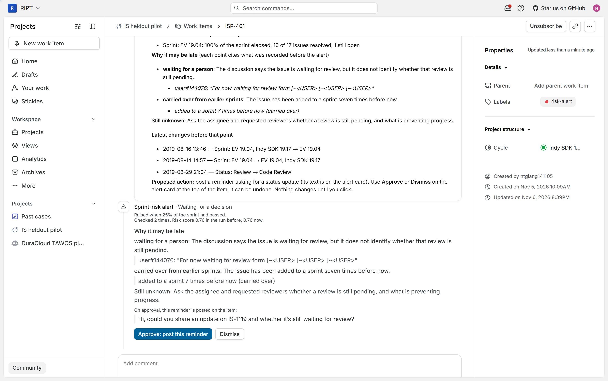
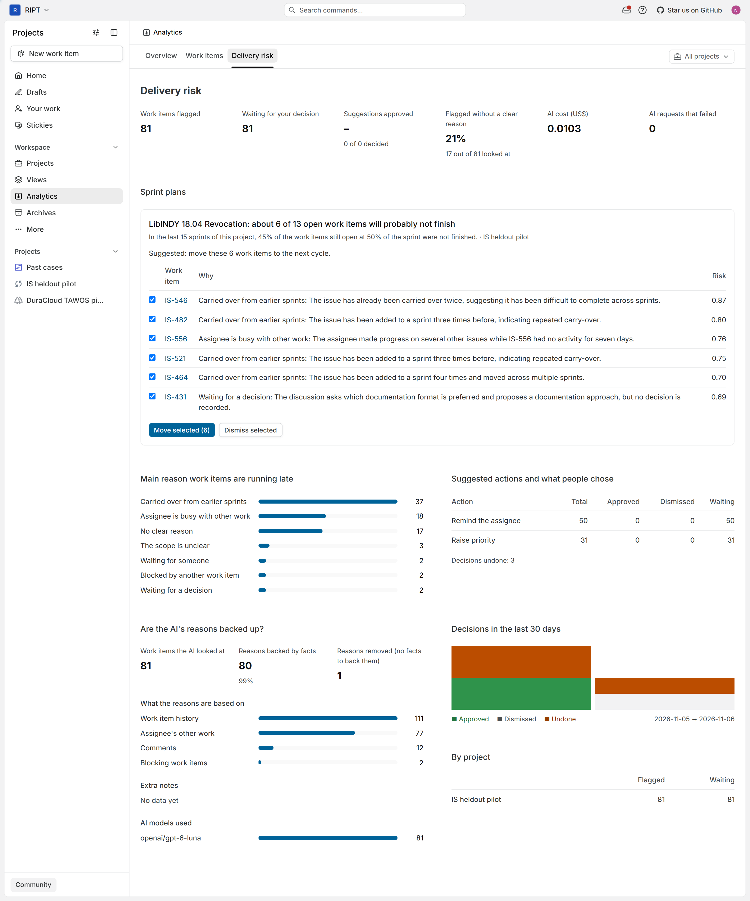
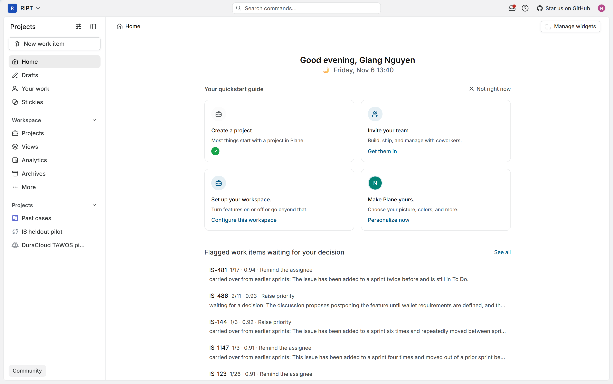
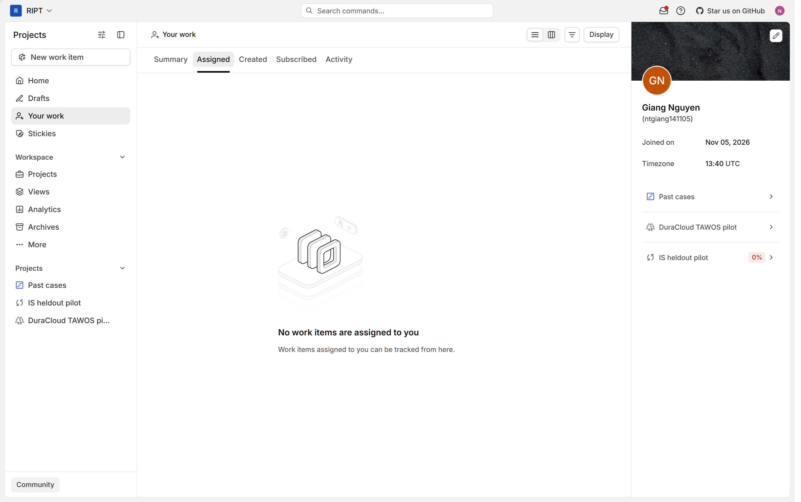
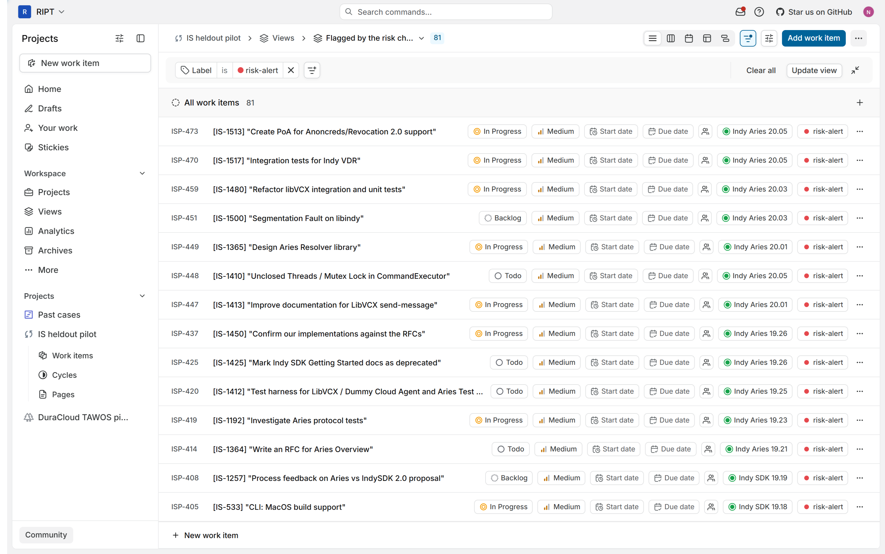
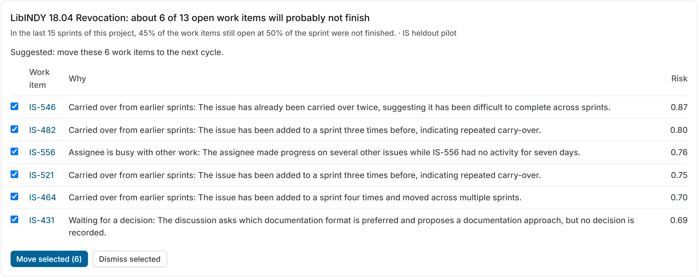
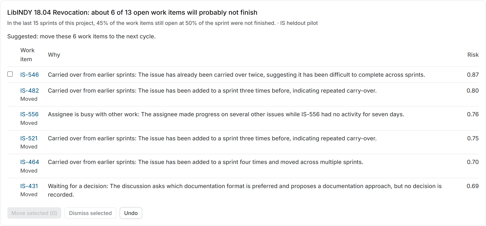
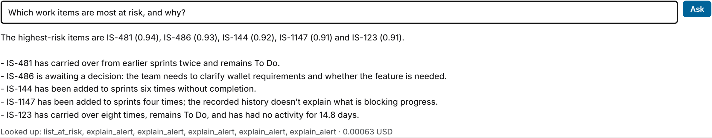

# TÓM TẮT

Báo cáo này trình bày kết quả thực hiện Nội dung 3 trong đề cương đăng ký đề tài mã số `04-SV-2026-RIPT`: xây dựng hệ thống API quản lý công việc, điều phối kế hoạch làm việc và giao diện người dùng. Thay vì viết lại các API CRUD cơ bản cho `Task`, `Phase`, `WorkSchedule` và `TimeLog` trên một ứng dụng rời như dự kiến trong đề cương tháng 5/2026, chúng tôi sử dụng nền tảng quản lý dự án mã nguồn mở Plane làm môi trường quản lý công việc và sprint (trong Plane gọi là cycle), nạp dữ liệu dự án IS từ bộ dữ liệu TAWOS [6] vào Plane dưới mã dự án ISP, và xây dựng dịch vụ backend FastAPI (`agentick-backend`) kết nối trực tiếp với giao diện React/MobX của Plane. Hệ thống cung cấp đầy đủ các chức năng phục vụ điều phối tiến độ: thẻ cảnh báo ngay trên màn hình chi tiết từng issue với ba thao tác Duyệt, Bỏ qua và Hoàn tác (module M4-M7), sổ cảnh báo theo dõi biến động điểm rủi ro qua các lần kiểm tra (module M17), module lập kế hoạch cấp sprint kèm phê duyệt và hoàn tác theo lô để dời các công việc vượt sức chứa sang sprint kế tiếp (module M14, M15), cùng bộ giao diện giám sát rủi ro tại tab `Delivery risk`, trang chủ `Home`, trang cá nhân `Your work`, chế độ xem đã lưu và khung hỏi đáp `Ask` (module M9-M12, M16). Toàn bộ 89 bài kiểm thử tự động của khối backend, kiểm tra kiểu tĩnh TypeScript (`tsc`) và kiểm tra hợp đồng OpenAPI bằng Spectral đều đạt 0 lỗi.

Từ khóa: ứng dụng web, Plane, FastAPI, thẻ cảnh báo, kế hoạch sprint, duyệt theo lô, phân quyền dự án.

# CHƯƠNG 1. ĐỐI CHIẾU VỚI ĐỀ CƯƠNG GỐC VÀ CÁC QUYẾT ĐỊNH ĐIỀU CHỈNH

Trong mục 11 của đề cương đăng ký đề tài (tháng 5/2026), Nội dung 3 gồm các hạng mục: "Xây dựng module quản lý công việc, lịch làm việc và time tracking" với kết quả cần đạt là "API hoàn chỉnh cho Task, Phase, Project, WorkSchedule, TimeLog; giao diện người dùng cơ bản". Trong quá trình triển khai, để tập trung nguồn lực vào bài toán phát hiện và xử lý sớm nguy cơ trễ hạn sprint thay vì làm lại các tính năng quản lý tác vụ tiêu chuẩn, chúng tôi đã thực hiện các điều chỉnh trong bảng 1.1.

Bảng 1.1. Đối chiếu kế hoạch trong đề cương gốc và kết quả triển khai thực tế ở Nội dung 3

| Hạng mục trong đề cương gốc (05/2026) | Nội dung dự kiến ban đầu | Quyết định triển khai trong nghiên cứu hiện tại | Lý do và giá trị mang lại |
|---|---|---|---|
| Quản lý `Task`, `Phase`, `Project` | Tự xây dựng API và giao diện cơ bản cho project, phase, task từ đầu | Sử dụng nền tảng mã nguồn mở Plane tự chủ (self-hosted); ánh xạ `Project` sang project của Plane, `Phase`/sprint sang `Cycle` và `Task` sang `Work Item` (issue); nạp dự án IS của TAWOS [6] thành dự án ISP trên Plane | Plane đã có sẵn hệ thống quản lý issue, cycle, nhãn, bình luận và phân quyền người dùng hoàn chỉnh; tích hợp trực tiếp giúp người quản lý nhận cảnh báo ngay tại nơi làm việc |
| Quản lý lịch làm việc (`WorkSchedule`) | API phân bổ lịch làm việc thủ công cho từng cá nhân | Chuyển thành module lập kế hoạch cấp sprint (M14) và duyệt/hoàn tác theo lô (M15): tính số không xong dự kiến $b$ từ sức chứa lịch sử, đề xuất tập chuyển và dời các issue được chọn sang cycle kế tiếp qua một lần bấm | Giải quyết trực tiếp tình trạng sprint nhận quá nhiều việc so với khả năng hoàn thành thực tế của đội; hỗ trợ chọn/bỏ chọn từng dòng và hoàn tác cả lô |
| Theo dõi thời gian (`TimeLog` / Time tracking) | Người dùng tự nhập số giờ làm việc thủ công | Thay bằng việc trích xuất tự động lịch sử hoạt động thực tế từ bảng `change_log` (số ngày không có hoạt động, các lần chuyển trạng thái, hoạt động của người phụ trách trong 7 ngày gần nhất) kết hợp sổ cảnh báo (M17) | Dữ liệu TAWOS [6] và quy trình Scrum thực tế theo dõi tiến độ qua nhật ký sự kiện thay vì bấm giờ thủ công; giảm phụ thuộc vào báo cáo cảm tính của từng cá nhân |
| Giao diện người dùng cơ bản | Các màn hình danh sách công việc và biểu mẫu nhập liệu đơn giản | Xây dựng 5 nhóm giao diện chuyên biệt nhúng trong Plane: thẻ cảnh báo trên từng issue (M6), tab phân tích `Delivery risk` (M10), bảng cảnh báo ở `Home` (M11), màn hình `Your work` kèm chế độ xem `"Flagged by the risk check"` (M12), thẻ kế hoạch sprint (M14, M15) và khung hỏi đáp `Ask` (M16) | Phục vụ đầy đủ hai cấp độ quản lý: xử lý từng issue riêng lẻ và điều phối sức chứa toàn sprint |

# CHƯƠNG 2. XÂY DỰNG DỊCH VỤ BACKEND VÀ CƠ CHẾ PHÊ DUYỆT HÀNH ĐỘNG

## 2.1. Các nhóm API của dịch vụ agentick-backend

Dịch vụ `agentick-backend` được xây dựng bằng FastAPI, SQLAlchemy 2 và PostgreSQL 16, là cầu nối giữa các tác vụ phân tích rủi ro và ứng dụng Plane. Mọi đặc tả endpoint đều được kiểm tra tự động bằng công cụ lint OpenAPI (Spectral) và kiểm thử hợp đồng (`test_openapi_contract.py`). Bảng 2.1 tổng hợp các nhóm endpoint chính của hệ thống.

Bảng 2.1. Các nhóm API của dịch vụ `agentick-backend`

| Nhóm API | Đường dẫn chính | Chức năng xử lý |
|---|---|---|
| Quản lý cảnh báo cấp issue (M4, M5, M17) | `POST /api/v1/alerts/publish`, `GET /api/v1/alerts`, `GET /api/v1/alerts/by-issue/{issue_id}` | Nhận thẻ cảnh báo từ tiến trình nền; cập nhật số lần kiểm tra (`seen_count`), điểm liền trước (`prev_score`) và tự mở lại cảnh báo đã bỏ qua nếu điểm rủi ro tăng thêm từ 0,15 trở lên; trả về danh sách cảnh báo theo quyền xem |
| Phê duyệt và hoàn tác cấp issue (M4, M7) | `POST /api/v1/alerts/{id}/decide`, `POST /api/v1/alerts/{id}/undo` | Xác thực phiên đăng nhập Plane của người dùng, gọi API của Plane để thực thi hành động đóng (`raise_priority`, `nudge_owner`, `move_next_cycle`), lưu trạng thái trước khi sửa và khôi phục lại khi bấm Hoàn tác |
| Thống kê giám sát rủi ro (M9) | `GET /api/v1/insights/summary`, `GET /api/v1/insights/home`, `GET /api/v1/insights/your-work` | Tổng hợp số lượng cảnh báo, phân bố nguyên nhân đứng đầu, tỉ lệ bám bằng chứng, chi phí gọi mô hình, lịch sử quyết định theo ngày và danh sách cảnh báo chờ xử lý trong các dự án người dùng có quyền xem |
| Kế hoạch cấp sprint và duyệt theo lô (M14, M15) | `POST /api/v1/plans/publish`, `GET /api/v1/plans`, `POST /api/v1/plans/{id}/decide`, `POST /api/v1/plans/{id}/undo` | Lưu kế hoạch cấp sprint; nhận danh sách các dòng issue người dùng tích chọn để chuyển sang cycle kế tiếp theo lô; ghi nhận lỗi riêng từng dòng và hoàn tác toàn bộ các dòng đã chuyển |
| Agent hỏi đáp chỉ đọc (M16) | `POST /api/v1/assistant/ask` | Nhận câu hỏi ngôn ngữ tự nhiên, chạy vòng lặp gọi 5 công cụ chỉ đọc đã lọc theo quyền xem dự án của phiên Plane và trả về câu trả lời kèm danh sách công cụ đã tra cứu |

## 2.2. Cơ chế thực thi hành động đóng, Hoàn tác và kiểm soát quyền xem

Để bảo đảm an toàn khi tích hợp vào môi trường làm việc thực tế, hệ thống không cho phép tự động sửa đổi dữ liệu công việc. Tập hành động thực thi tự động qua API của Plane được khóa cố định ở ba thao tác:
1. Nâng mức ưu tiên của issue lên mức `High` (`raise_priority`), lưu lại mức ưu tiên cũ (ví dụ `Medium` hoặc `Low`) để khôi phục khi Hoàn tác.
2. Đăng bình luận nhắc người phụ trách trên issue (`nudge_owner`), lưu lại định danh bình luận vừa tạo để xóa bình luận đó khi Hoàn tác.
3. Chuyển issue sang sprint (cycle) kế tiếp (`move_next_cycle`), lưu lại định danh cycle gốc để đưa issue quay về cycle cũ khi Hoàn tác.

Trong cả luồng duyệt đơn lẻ (mục 4.6 báo cáo chính) lẫn luồng duyệt theo lô trên thẻ kế hoạch sprint (module M15), dịch vụ backend luôn thực hiện lời gọi sang API của Plane trước khi cập nhật trạng thái trong cơ sở dữ liệu risk. Nếu API của Plane trả về lỗi ở một dòng issue, dòng đó được ghi nhận lỗi riêng mà không làm hỏng trạng thái của các dòng hợp lệ khác.

Về kiểm soát quyền truy cập, ở mỗi yêu cầu gửi tới `agentick-backend`, hệ thống chuyển tiếp cookie phiên đăng nhập của người dùng sang Plane để lấy danh sách các dự án mà tài khoản đó được phép truy cập. Các bảng thống kê chỉ đếm cảnh báo thuộc tập dự án này; đồng thời nếu một sự kiện bằng chứng trên thẻ cảnh báo có nhắc tới mã issue của một dự án khác mà người đang xem không có quyền truy cập, backend tự động thay thế dòng mô tả bằng bản đã ẩn tiêu đề.

# CHƯƠNG 3. GIAO DIỆN NGƯỜI DÙNG TRÊN NỀN TẢNG PLANE

Giao diện người dùng được xây dựng trực tiếp trong mã nguồn giao diện web của Plane (React, MobX, TypeScript, hỗ trợ song ngữ Anh - Việt). Các hình chụp màn hình dưới đây được ghi nhận trên 81 cảnh báo thực tế của dự án ISP (Indy SDK) ở lượt chạy thứ hai sau khi cập nhật quy tắc sắp xếp nguyên nhân.

## 3.1. Thẻ cảnh báo và sổ cảnh báo trên trang chi tiết issue

Trên màn hình chi tiết của mỗi issue có cảnh báo (minh họa với issue `ISP-401`, tương ứng `IS-1119` trong TAWOS, tại hình 3.1), hệ thống hiển thị hai phần. Phía trên là bình luận tổng hợp do tiến trình nền đăng vào luồng thảo luận của issue. Ngay phía dưới là thẻ cảnh báo tương tác: hiển thị mốc đánh giá $t$ (25% thời lượng sprint), dòng trạng thái từ sổ cảnh báo (`"Checked 2 times. Risk score 0.76 in the run before, 0.76 now"`), danh sách giả thuyết nguyên nhân kèm sự kiện trích dẫn, câu hỏi cần làm rõ, nội dung câu nhắc đề xuất và hai nút `Approve` (Duyệt) / `Dismiss` (Bỏ qua). Sau khi bấm Duyệt, thẻ hiển thị nút `Undo` (Hoàn tác).

Hình 3.1. Giao diện thẻ cảnh báo, dòng trạng thái sổ cảnh báo và các nút phê duyệt trên trang chi tiết issue ISP-401 trong Plane

## 3.2. Các màn hình giám sát rủi ro cấp dự án và cá nhân

Trong mục `Analytics` của Plane, chúng tôi bổ sung tab `Delivery risk` (hình 3.2) làm bảng điều khiển trung tâm cho người quản lý dự án. Đầu trang hiển thị hàng chỉ số tổng hợp của dự án đang chọn: tổng số 81 cảnh báo, 81 cảnh báo đang chờ quyết định, 17 trên 81 thẻ ở trạng thái chưa rõ nguyên nhân, tổng chi phí gọi LLM là 0,0103 USD với 0 lượt lỗi, và chỉ số `"Decisions undone: 3"` ghi nhận 3 lượt hoàn tác trong quá trình kiểm thử. Bên dưới là biểu đồ phân bố nguyên nhân đứng đầu, thống kê hành động đề xuất, tỉ lệ bám bằng chứng (80 trên 81 thẻ có nguyên nhân được sự kiện hỗ trợ, 1 giả thuyết bị verifier loại bỏ) và bảng tổng hợp theo dự án. Bộ lọc dự án ở góc trên tự động áp dụng cho toàn bộ số liệu trong tab.

Hình 3.2. Giao diện tab phân tích Delivery risk trong mục Analytics của Plane

Để trưởng nhóm theo dõi nhanh ngay khi mở ứng dụng, trang chủ `Home` được tích hợp bảng danh sách các cảnh báo đang chờ phê duyệt kèm mã issue, thứ hạng rủi ro trong sprint, điểm rủi ro, hành động đề xuất và nguyên nhân đứng đầu (hình 3.3). Tại trang cá nhân `Your work` (hình 3.4, nửa trên), danh sách hiện để trống vì mã người phụ trách trong bộ dữ liệu lịch sử TAWOS đã bị ẩn danh hóa nên không trùng với tài khoản đang đăng nhập trên Plane; để khắc phục khi duyệt toàn bộ danh sách công việc rủi ro theo giao diện bảng chuẩn của Plane, chúng tôi cấu hình chế độ xem đã lưu (`saved view`) mang tên `"Flagged by the risk check"` lọc theo nhãn `risk-alert`, hiển thị đầy đủ 81 issue có cảnh báo (hình 3.4, nửa dưới).

Hình 3.3. Bảng danh sách cảnh báo chờ duyệt trên trang chủ Home của Plane

Hình 3.4. Màn hình Your work trống do mã người phụ trách ẩn danh trong TAWOS (trên) và chế độ xem đã lưu "Flagged by the risk check" hiển thị 81 issue có cảnh báo (dưới)

## 3.3. Giao diện kế hoạch cấp sprint, duyệt theo lô và khung hỏi đáp

Ngay trong tab `Delivery risk`, thẻ kế hoạch cấp sprint (hình 3.5) hỗ trợ người quản lý cân đối lại khối lượng công việc của sprint đang chạy. Hình 3.5 minh họa kế hoạch của sprint `"LibINDY 18.04 Revocation"` tại mốc 50% thời lượng (chạy qua chế độ phát lại `--demo` tạo hai cycle đang mở trên Plane): sprint còn 13 issue đang mở; từ 15 sprint lịch sử liền trước với tỉ lệ không hoàn thành 45%, hệ thống báo số không xong dự kiến là $b = 6$ issue và đề xuất tập chuyển gồm 6 issue có điểm rủi ro cao nhất (`IS-546`, `IS-482`, `IS-556`, `IS-521`, `IS-464`, `IS-431`) kèm nguyên nhân đã qua verifier.

Người quản lý có thể tích chọn hoặc bỏ chọn từng dòng trước khi bấm phê duyệt cả lô. Trên hình 3.6, chúng tôi bỏ chọn dòng `IS-546` và bấm duyệt cho 5 dòng còn lại: cả 5 issue được chọn đều chuyển sang cycle kế tiếp trên Plane, trong khi `IS-546` giữ nguyên ở cycle hiện tại. Nút `Undo` cho phép hoàn tác một lần để đưa cả 5 issue về lại cycle cũ.

Hình 3.5. Thẻ kế hoạch cấp sprint của sprint "LibINDY 18.04 Revocation" với 6 dòng issue trong tập chuyển

Hình 3.6. Kết quả phê duyệt theo lô sau khi bỏ chọn IS-546 và chuyển 5 issue còn lại sang cycle kế tiếp; nút Undo cho phép hoàn tác cả lô

Bên dưới thẻ kế hoạch là khung hỏi đáp `"Ask about delivery risk"` (hình 3.7). Người dùng nhập câu hỏi bằng tiếng Việt hoặc tiếng Anh; câu trả lời hiển thị trực tiếp bên dưới kèm mã issue, điểm số, nguyên nhân và dòng trạng thái `"Looked up"` ghi rõ số lần gọi từng công cụ cùng chi phí truy vấn (trên hình 3.7 là 1 lần gọi `list_at_risk`, 5 lần gọi `explain_alert`, chi phí 0,00063 USD).

Hình 3.7. Giao diện khung hỏi đáp Ask trong tab Delivery risk của Plane

# TÀI LIỆU THAM KHẢO

1. E. Debenedetti, J. Zhang, M. Balunović, L. Beurer-Kellner, M. Fischer, F. Tramèr, "AgentDojo: A Dynamic Environment to Evaluate Prompt Injection Attacks and Defenses for LLM Agents," NeurIPS 2024 Datasets and Benchmarks Track. arXiv:2406.13352.
2. K. Greshake, S. Abdelnabi, S. Mishra, C. Endres, T. Holz, M. Fritz, "Not what you've signed up for: Compromising Real-World LLM-Integrated Applications with Indirect Prompt Injection," 2023. arXiv:2302.12173.
3. K. Kubrak, F. Milani, A. Nolte, M. Dumas, "Prescriptive Process Monitoring: Quo Vadis?," PeerJ Computer Science, 2022. arXiv:2112.01769.
4. X. Liu, R. Zhang, A. H. Abdi, M. Galley, Z. Chen, S. Xiong, X. Wang, J. Gao, "Do Proactive Agents Need an LLM to Decide When to Act?," preprint, 2026. arXiv:2605.30152.
5. L. Prokhorenkova, G. Gusev, A. Vorobev, A. V. Dorogush, A. Gulin, "CatBoost: unbiased boosting with categorical features," NeurIPS 2018. arXiv:1706.09516.
6. V. Tawosi, A. Al-Subaihin, R. Moussa, F. Sarro, "A Versatile Dataset of Agile Open Source Software Projects," MSR 2022. arXiv:2202.00979.
7. V. Tawosi, R. Moussa, F. Sarro, "Agile Effort Estimation: Have We Solved the Problem Yet? Insights From A Replication Study," IEEE Transactions on Software Engineering, 2022. arXiv:2201.05401.
8. I. Teinemaa, M. Dumas, M. La Rosa, F. M. Maggi, "Outcome-Oriented Predictive Process Monitoring: Review and Benchmark," ACM Transactions on Knowledge Discovery from Data, 13(2), 2019. arXiv:1707.06766.
9. F. Tu, J. Zhu, Q. Zheng, M. Zhou, "Be Careful of When: An Empirical Study on Time-Related Misuse of Issue Tracking Data," ESEC/FSE 2018. doi:10.1145/3236024.3236054.
10. S. Yao, N. Shinn, P. Razavi, K. Narasimhan, "τ-bench: A Benchmark for Tool-Agent-User Interaction in Real-World Domains," 2024. arXiv:2406.12045.
