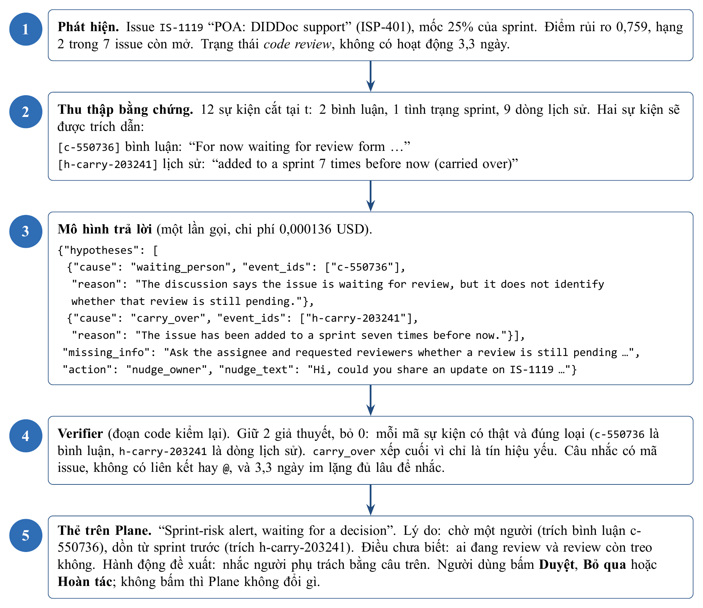
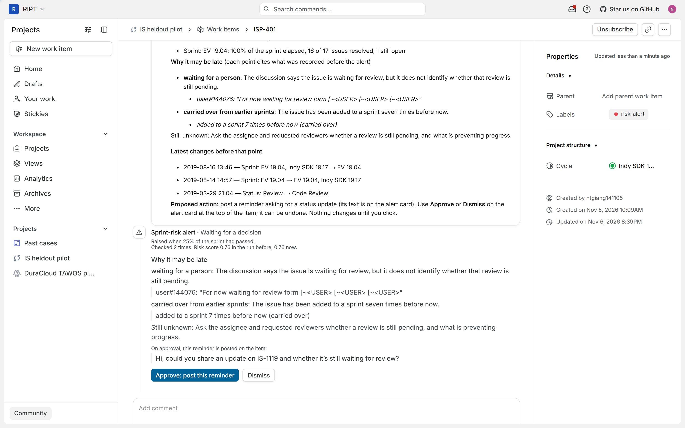
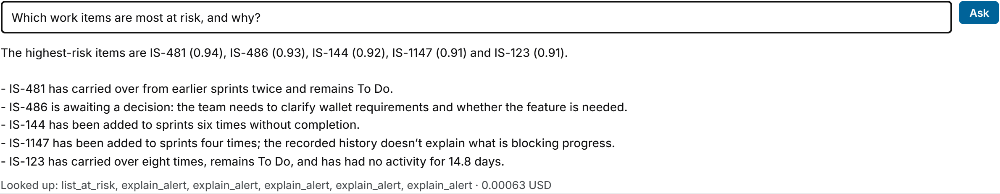

# TÓM TẮT

Báo cáo này trình bày kết quả thực hiện Nội dung 4 trong đề cương đăng ký đề tài mã số `04-SV-2026-RIPT`: xây dựng mô hình đánh giá rủi ro trễ hạn, cơ chế phát cảnh báo chủ động và các thành phần AI Agent hỗ trợ can thiệp sớm. So với đề cương gốc (tháng 5/2026) vốn dự kiến dùng agent để vừa tính điểm rủi ro, vừa dự báo ngày hoàn thành và đẩy thông báo qua email/Telegram, hệ thống hiện tại tách bạch rõ phần tính toán định lượng bằng thuật toán với phần giải thích ngôn ngữ của LLM [4]. Cụ thể, điểm rủi ro $p(t)$ của từng issue đang mở tại mốc $t$ được tính bằng mô hình CatBoost động [5] trên năm nhóm đặc trưng lịch sử cắt tại mốc $t$ [9], hiệu chuẩn bằng hàm logistic và chọn cảnh báo theo ngân sách $K = \lceil 0,2n \rceil$. Với mỗi cảnh báo được chọn, bộ thu thập chạy năm truy vấn SQL cố định để lấy sự kiện lịch sử trước mốc $t$, gọi LLM (`openai/gpt-6-luna`) một lần để sinh tối đa ba giả thuyết nguyên nhân trong tập đóng 6 nhãn kèm câu nhắc, rồi lọc qua bước kiểm tra bằng code (verifier) và bổ sung hai ghi chú bối cảnh theo luật. Ở cấp toàn sprint, thuật toán thống kê ước lượng số không xong dự kiến $b$ từ các sprint lịch sử và chọn tập chuyển có đóng bắc cầu theo chuỗi chặn. Thay vì gửi thông báo rời qua email hoặc Telegram dễ gây nhiễu và lộ dữ liệu dự án, cảnh báo được đăng trực tiếp thành thẻ tương tác ngay trên từng issue trong Plane và quản lý vòng đời qua sổ cảnh báo (tự mở lại khi điểm rủi ro tăng từ 0,15 trở lên), đi kèm agent hỏi đáp chỉ đọc sử dụng 5 công cụ định kiểu chặt.

Từ khóa: CatBoost, chẩn đoán nguyên nhân, bộ thu thập SQL, verifier, kế hoạch cấp sprint, agent hỏi đáp, sổ cảnh báo.

# CHƯƠNG 1. ĐỐI CHIẾU VỚI ĐỀ CƯƠNG GỐC VÀ CÁC QUYẾT ĐỊNH ĐIỀU CHỈNH

Trong mục 11 của đề cương đăng ký đề tài (tháng 5/2026), Nội dung 4 có nhiệm vụ: "Xây dựng AI Agent: phân tích rủi ro, dự báo deadline, cơ chế cảnh báo chủ động qua email và Telegram" với kết quả cần đạt là "Agent hoạt động end-to-end: tính risk score, gửi cảnh báo, tạo báo cáo tự động theo lịch". Bảng 1.1 ghi nhận các thay đổi về phương pháp dự báo, thiết kế agent và kênh phân phối cảnh báo so với đề cương ban đầu.

Bảng 1.1. Đối chiếu thiết kế trong đề cương gốc và quyết định xây dựng thực tế ở Nội dung 4

| Hạng mục trong đề cương gốc (05/2026) | Nội dung dự kiến ban đầu | Quyết định xây dựng trong nghiên cứu hiện tại | Lý do kỹ thuật và thực nghiệm |
|---|---|---|---|
| Tính điểm rủi ro (`risk score`) và dự báo deadline | Giao cho AI Agent tính điểm rủi ro và dự báo ngày hoàn thành của từng công việc | Dùng mô hình học máy CatBoost động [5] tính xác suất không kịp hoàn thành trong sprint $p(t)$ từ 5 nhóm đặc trưng cắt tại mốc $t$; ở cấp sprint tính số không xong dự kiến $b$ từ tỉ lệ lịch sử | Điểm rủi ro tính bằng CatBoost tái lập được và kiểm định được trên 18.322 cặp issue-sprint [4, 5]; ước lượng thời gian từng issue có sai số lớn (thực nghiệm E6, [7]) nên thay bằng ước lượng sức chứa cấp sprint |
| Phân tích nguyên nhân rủi ro bằng AI Agent | Agent tự do đọc dữ liệu và viết báo cáo phân tích rủi ro | Đặt một lượt gọi LLM giữa bộ thu thập 5 truy vấn SQL cố định (cắt tại mốc $t$) và bước hậu kiểm bằng code (`verifier`); phân loại vào 6 nhãn nguyên nhân đóng; sau đợt đo M13 bổ sung quy tắc đẩy `carry_over` xuống cuối thẻ | Chặn việc LLM tự bịa sự kiện không có trong lịch sử hoặc bị dẫn dụ bởi lệnh tiêm nhiễm trong bình luận [1, 2]; sửa hiện tượng nhãn `carry_over` lấn át nguyên nhân cụ thể ở 41/81 thẻ |
| Cơ chế cảnh báo chủ động qua email và Telegram | Gửi thông báo đẩy qua email và Telegram theo lịch | Cắt bỏ kênh gửi email/Telegram bên ngoài; thay bằng tiến trình nền đăng bình luận tóm tắt và thẻ cảnh báo trực tiếp vào từng issue trên Plane (M5, M6), kết hợp sổ cảnh báo theo dõi vòng đời (M17) | Giữ cảnh báo gắn liền với ngữ cảnh thảo luận và các nút Duyệt / Bỏ qua / Hoàn tác ngay trên Plane; tránh lộ thông tin dự án qua kênh chat bên thứ ba và chống báo lặp bằng sổ cảnh báo |
| Tương tác tra cứu báo cáo rủi ro | Tạo báo cáo tĩnh tự động theo lịch | Xây dựng thêm agent hỏi đáp chỉ đọc (M16) với 5 công cụ định kiểu chặt và bộ lọc mã issue ở đầu ra | Cho phép người quản lý chủ động hỏi nguyên nhân, danh sách rủi ro và kế hoạch sprint bằng tiếng Việt hoặc tiếng Anh ngay trong tab `Delivery risk` |

# CHƯƠNG 2. PHƯƠNG PHÁP DỰ BÁO, CHẨN ĐOÁN VÀ XÂY DỰNG AGENT

## 2.1. Khối phát hiện rủi ro bằng mô hình CatBoost động

Tại mỗi mốc $t$ (0%, 25%, 50% và 75% thời lượng sprint), mỗi cặp issue-sprint được trích xuất năm nhóm đặc trưng từ dữ liệu đã diễn ra trước hoặc tại mốc $t$ (bảng 2.1). Mô hình tĩnh chỉ dùng đặc trưng tại $t = 0\%$, trong khi mô hình động sử dụng toàn bộ năm nhóm đặc trưng cập nhật đến mốc $t$.

Bảng 2.1. Năm nhóm đặc trưng đầu vào của mô hình CatBoost tại mốc t

| Nhóm đặc trưng | Các đặc trưng thành phần | Nguồn tái dựng tại mốc $t$ |
|---|---|---|
| 1. Thời gian | Độ dài sprint, số ngày đã trôi qua tính đến mốc $t$, số ngày còn lại của sprint | Thời điểm bắt đầu/kết thúc sprint và mốc $t$ |
| 2. Trạng thái thực thi | Trạng thái hiện tại tại mốc $t$, cờ đã hoàn thành, số ngày liên tiếp không có hoạt động | Tái dựng từ `change_log` và `comment` có dấu thời gian $\le t$ |
| 3. Cường độ hoạt động | Tổng số sự kiện, số lần đổi trạng thái, số lần đổi người phụ trách, số lần đổi ước lượng trước mốc $t$ | Đếm trên các bản ghi `change_log` xảy ra trước hoặc tại mốc $t$ |
| 4. Thuộc tính tĩnh | Loại issue, mức ưu tiên, điểm ước lượng (story point), tuổi của issue tính từ ngày tạo | Thuộc tính lúc mở issue và giá trị ghi nhận ban đầu |
| 5. Bối cảnh sprint | Tổng số issue của sprint ($n$), tỉ lệ issue cùng sprint đã hoàn thành tại mốc $t$ | Tổng hợp trên các issue cùng sprint tính đến mốc $t$ |

Cả hai mô hình sử dụng thuật toán CatBoost [5] với cấu hình khóa cố định trước khi huấn luyện: 400 cây quyết định, độ sâu tối đa 5, tốc độ học 0,05 và hệ số điều chuẩn L2 bằng 5. Điểm đầu ra $z(x)$ được hiệu chuẩn thành xác suất qua hàm logistic (Platt scaling) khớp trên tập validation:

$$P(y = 1 \mid x) = \frac{1}{1 + \exp(-(a \cdot z(x) + b))}$$

Trong mỗi sprint có $n$ issue đang mở và chưa bị hủy tại mốc $t$, bộ điều khiển chọn tối đa $K = \lceil 0,2n \rceil$ issue có xác suất rủi ro cao nhất để đưa vào danh sách cảnh báo.

## 2.2. Bộ thu thập năm truy vấn SQL và khối chẩn đoán kèm Verifier

Với mỗi cảnh báo, bộ thu thập thực thi năm truy vấn SQL cố định (không dùng AI) để trích xuất các sự kiện có dấu thời gian không vượt quá $t$. Mỗi bản ghi sự kiện có định dạng `"[event_id] loại ngày: nội dung"`:
1. Thảo luận (`c-...`): tối đa 8 bình luận gần nhất trước mốc $t$, cắt tối đa 400 ký tự mỗi bình luận.
2. Hoạt động của người phụ trách (`a-...`): xác định người phụ trách tại mốc $t$ từ `change_log`, lấy tối đa 5 lần người này cập nhật trạng thái trên các issue khác trong 7 ngày trước mốc $t$.
3. Chuỗi chặn (`b-...`): lần theo liên kết phụ thuộc có hướng ("issue A chờ issue B") đến độ sâu 2 và lấy trạng thái tại mốc $t$ của các issue chặn (loại bỏ 446 liên kết `"is dependent of"` và 52 liên kết `"requires"` do không xác định được chiều phụ thuộc).
4. Tình trạng sprint (`s-...`): phần trăm thời lượng sprint đã trôi qua, số issue đã hoàn thành và số issue còn mở tại mốc $t$.
5. Lịch sử thay đổi và dồn sprint (`h-...`): tối đa 8 lần đổi trạng thái, mức ưu tiên, người phụ trách, sprint hoặc story point trước mốc $t$, kèm sự kiện `h-carry-...` ghi nhận tổng số lần issue được đưa vào sprint nếu từng bị dồn qua nhiều sprint.

Tiêu đề issue và danh sách sự kiện trên được bọc vào khối `<untrusted>` (sau khi đã lọc bỏ mọi chuỗi `"untrusted"` có sẵn trong văn bản gốc) và gửi vào một lượt gọi LLM (`openai/gpt-6-luna` qua OpenRouter). Mô hình trả về đối tượng JSON gồm tối đa 3 giả thuyết nguyên nhân, thông tin còn thiếu (`missing_info`), hành động đề xuất và câu nhắc (`nudge_text`). Ngay sau đó, bước hậu kiểm bằng code (`verifier`) kiểm tra từng giả thuyết theo bảng 2.2.

Bảng 2.2. Sáu nhãn nguyên nhân đóng và điều kiện hậu kiểm của Verifier

| Mã nhãn nguyên nhân | Ý nghĩa | Loại sự kiện bắt buộc phải trích dẫn trong `event_ids` | Quy tắc sắp xếp trong Verifier |
|---|---|---|---|
| `pulled_away` | Người phụ trách bị kéo sang xử lý các issue khác | Ít nhất 1 sự kiện hoạt động của người phụ trách trên issue khác (`a-...`) | Giữ theo thứ tự độ mạnh của mô hình |
| `blocked` | Issue đang bị chặn bởi một issue khác chưa xong | Ít nhất 1 sự kiện chuỗi chặn đang ở trạng thái mở (`b-...`) | Giữ theo thứ tự độ mạnh của mô hình |
| `waiting_person` | Đang chờ phản hồi hoặc review từ một cá nhân/nhóm | Ít nhất 1 sự kiện bình luận (`c-...`) | Giữ theo thứ tự độ mạnh của mô hình |
| `needs_decision` | Đang chờ quyết định kỹ thuật hoặc sản phẩm | Ít nhất 1 sự kiện bình luận (`c-...`) | Giữ theo thứ tự độ mạnh của mô hình |
| `unclear_scope` | Phạm vi hoặc yêu cầu công việc chưa rõ ràng | Ít nhất 1 sự kiện bình luận (`c-...`) | Giữ theo thứ tự độ mạnh của mô hình |
| `carry_over` | Issue bị dồn qua nhiều sprint liên tiếp | Sự kiện đếm số lần đưa vào sprint (`h-carry-...`) | Tự động đẩy xuống vị trí cuối cùng nếu thẻ có bất kỳ giả thuyết hợp lệ nào khác |

Việc loại bỏ giả thuyết trích dẫn mã sự kiện không tồn tại hoặc sai loại sự kiện đi kèm với kiểm tra câu nhắc `nudge_text`: `verifier` hủy câu nhắc nếu không chứa mã issue đang xét, dài ngoài khoảng 20-600 ký tự, chứa liên kết web, ký tự `@`, thẻ HTML, nêu sai số ngày ngừng hoạt động quá 1 ngày, nhắc tới mã issue của dự án khác, hoặc khi issue vừa có hoạt động trong 2 ngày gần nhất. Hệ thống cũng gán thêm hai ghi chú bối cảnh theo luật tất định: `sprint_overload` (khi sprint đã qua $\ge 50\%$ thời lượng, có $\ge 5$ issue và $\ge 60\%$ còn mở) và `done_not_updated` (khi bình luận trong 3 ngày trước mốc $t$ có từ khóa báo hoàn tất nhưng trạng thái chưa đóng).

## 2.3. Thuật toán lập kế hoạch cấp sprint, Agent hỏi đáp và Sổ cảnh báo

Ở cấp toàn sprint (module M14), gọi $\sub{S}{trước}$ là tập các sprint đã kết thúc trước thời điểm hiện tại trong cùng dự án. Với mỗi sprint $s \in \sub{S}{trước}$, gọi $\sub{O}{s}(t)$ là số issue còn mở tại mốc $t$ và $\sub{U}{s}(t)$ là số lượng trong số đó không hoàn thành khi kết thúc sprint. Tỉ lệ không hoàn thành lịch sử $r$ và số không xong dự kiến $b$ của sprint hiện tại (đang có $O(t)$ issue còn mở) được tính hoàn toàn bằng code:

$$r = \frac{\sum{s \in \sub{S}{trước}}{}{\sub{U}{s}(t)}}{\sum{s \in \sub{S}{trước}}{}{\sub{O}{s}(t)}}, \quad b = \mathrm{round}(r \cdot O(t))$$

Khi dự án có tối thiểu 3 sprint lịch sử và tổng số issue mở qua các sprint đó từ 15 trở lên, thuật toán chọn $b$ issue đang mở có điểm rủi ro $p(t)$ cao nhất đưa vào tập chuyển, sau đó đóng bắc cầu theo quan hệ phụ thuộc chờ-nhau: nếu issue A chờ issue B mà B nằm trong tập chuyển, A cũng được đưa vào tập chuyển với nhãn lý do `dependent` ("đi cùng"). Lý do hiển thị cho từng dòng trong tập chuyển được lấy từ thẻ cảnh báo đã qua `verifier` của chính issue đó.

Đối với agent hỏi đáp chỉ đọc (module M16), chúng tôi cài đặt vòng lặp gọi công cụ trực tiếp (tối đa 5 vòng, cắt kết quả mỗi lần gọi ở 4.000 ký tự) trên 5 công cụ định kiểu chặt: `list_at_risk` (liệt kê cảnh báo có điểm rủi ro cao nhất), `explain_alert` (lấy chi tiết chẩn đoán của một mã issue), `decision_summary` (thống kê nguyên nhân và quyết định phê duyệt), `sprint_plans` (tra cứu kế hoạch cấp sprint) và `search_alerts` (tìm cảnh báo theo từ khóa, hỗ trợ khớp cả dạng có dấu gạch dưới và khoảng trắng như `carry_over` / `"carry over"`). Cả 5 công cụ đều lọc quyền xem dự án ngay trong câu truy vấn SQL, bọc văn bản trả về trong thẻ `<untrusted>`, và câu trả lời cuối cùng đi qua bộ quét mã issue để chặn tuyệt đối việc nêu mã issue ngoài kết quả công cụ.

Để quản lý vòng đời cảnh báo qua các lần chạy định kỳ mà không gây phiền nhiễu (module M17), sổ cảnh báo lưu số lần kiểm tra (`seen_count`) và điểm rủi ro ở lần chạy trước (`prev_score`). Một cảnh báo đã bị người quản lý bấm Bỏ qua sẽ giữ trạng thái đóng ở các lần chạy tiếp theo, trừ khi điểm rủi ro mới tăng vọt tối thiểu 0,15 so với lần trước:

$$\sub{p}{mới} - \sub{p}{trước} \ge 0,15$$

Khi thỏa mãn điều kiện trên, dịch vụ risk tự động mở lại cảnh báo về trạng thái chờ duyệt và ghi nhận tác nhân trong nhật ký là `risk service`. Các cảnh báo đã được bấm Duyệt thì không bao giờ tự mở lại.

# CHƯƠNG 3. MINH HỌA LUỒNG HOẠT ĐỘNG ĐẦU-CUỐI TRÊN DỮ LIỆU THẬT

Hình 3.1 minh họa toàn bộ năm bước xử lý của hệ thống trên một cảnh báo thực tế của dự án IS: issue `IS-1119` (`"POA: DIDDoc support"`), tương ứng với mã `ISP-401` trên Plane, ở lượt chạy thứ hai.

Hình 3.1. Sơ đồ năm bước xử lý thực tế của cảnh báo ISP-401 (IS-1119) từ chấm điểm phát hiện đến hiển thị thẻ phê duyệt trên Plane

Tại bước 1 (phát hiện), ở mốc $t = 25\%$ thời lượng sprint, `IS-1119` đang ở trạng thái `Code Review` và đã 3,3 ngày không có hoạt động. Mô hình CatBoost chấm điểm rủi ro $p(t) = 0,759$ (đứng thứ 2 trong 7 issue đủ điều kiện của sprint), đưa issue vào danh sách cảnh báo.

Tại bước 2 (bộ thu thập SQL), năm truy vấn trả về 12 sự kiện trước mốc $t$ (ngày 19/8/2019), trong đó có bình luận `c-550736` ghi nhận công việc đang chờ ba thành viên vào review mã nguồn của pull request, và sự kiện lịch sử `h-carry-203241` ghi nhận issue đã được đưa vào sprint 7 lần.

Tại bước 3 (chẩn đoán bằng LLM), mô hình trả về 2 giả thuyết: `waiting_person` (trích dẫn `c-550736`) và `carry_over` (trích dẫn `h-carry-203241`), gợi ý hỏi người phụ trách cùng nhóm review xem còn vướng ở đâu, đồng thời đề xuất hành động `nudge_owner` kèm câu nhắc `"Hi, could you share an update on IS-1119 and whether it's still waiting for review?"` (chi phí gọi API là 0,000136 USD).

Tại bước 4 (`verifier`), bước kiểm tra xác nhận cả hai mã sự kiện đều tồn tại và khớp loại sự kiện quy định, xếp `carry_over` ở vị trí thứ hai sau `waiting_person`, và chấp nhận câu nhắc (bỏ 0 giả thuyết).

Tại bước 5 (hiển thị và phê duyệt trên Plane), thẻ cảnh báo và dòng trạng thái của sổ cảnh báo được hiển thị trên trang chi tiết issue `ISP-401` (hình 3.2), đồng thời có thể tra cứu trực tiếp qua agent hỏi đáp trong tab `Delivery risk` (hình 3.3). Khi đối chiếu với bộ nhãn của người chấm độc lập ở module M13, cả nhãn chính (`waiting_person`) và nhãn phụ (`carry_over`) của hệ thống đều trùng khớp hoàn toàn với nhãn của người chấm.

Hình 3.2. Kết quả chẩn đoán và sổ cảnh báo của ISP-401 hiển thị trên Plane chờ người dùng bấm Duyệt hoặc Bỏ qua

Hình 3.3. Agent hỏi đáp chỉ đọc truy xuất danh sách cảnh báo và giải thích nguyên nhân qua 5 công cụ định kiểu chặt

# TÀI LIỆU THAM KHẢO

1. E. Debenedetti, J. Zhang, M. Balunović, L. Beurer-Kellner, M. Fischer, F. Tramèr, "AgentDojo: A Dynamic Environment to Evaluate Prompt Injection Attacks and Defenses for LLM Agents," NeurIPS 2024 Datasets and Benchmarks Track. arXiv:2406.13352.
2. K. Greshake, S. Abdelnabi, S. Mishra, C. Endres, T. Holz, M. Fritz, "Not what you've signed up for: Compromising Real-World LLM-Integrated Applications with Indirect Prompt Injection," 2023. arXiv:2302.12173.
3. K. Kubrak, F. Milani, A. Nolte, M. Dumas, "Prescriptive Process Monitoring: Quo Vadis?," PeerJ Computer Science, 2022. arXiv:2112.01769.
4. X. Liu, R. Zhang, A. H. Abdi, M. Galley, Z. Chen, S. Xiong, X. Wang, J. Gao, "Do Proactive Agents Need an LLM to Decide When to Act?," preprint, 2026. arXiv:2605.30152.
5. L. Prokhorenkova, G. Gusev, A. Vorobev, A. V. Dorogush, A. Gulin, "CatBoost: unbiased boosting with categorical features," NeurIPS 2018. arXiv:1706.09516.
6. V. Tawosi, A. Al-Subaihin, R. Moussa, F. Sarro, "A Versatile Dataset of Agile Open Source Software Projects," MSR 2022. arXiv:2202.00979.
7. V. Tawosi, R. Moussa, F. Sarro, "Agile Effort Estimation: Have We Solved the Problem Yet? Insights From A Replication Study," IEEE Transactions on Software Engineering, 2022. arXiv:2201.05401.
8. I. Teinemaa, M. Dumas, M. La Rosa, F. M. Maggi, "Outcome-Oriented Predictive Process Monitoring: Review and Benchmark," ACM Transactions on Knowledge Discovery from Data, 13(2), 2019. arXiv:1707.06766.
9. F. Tu, J. Zhu, Q. Zheng, M. Zhou, "Be Careful of When: An Empirical Study on Time-Related Misuse of Issue Tracking Data," ESEC/FSE 2018. doi:10.1145/3236024.3236054.
10. S. Yao, N. Shinn, P. Razavi, K. Narasimhan, "τ-bench: A Benchmark for Tool-Agent-User Interaction in Real-World Domains," 2024. arXiv:2406.12045.
