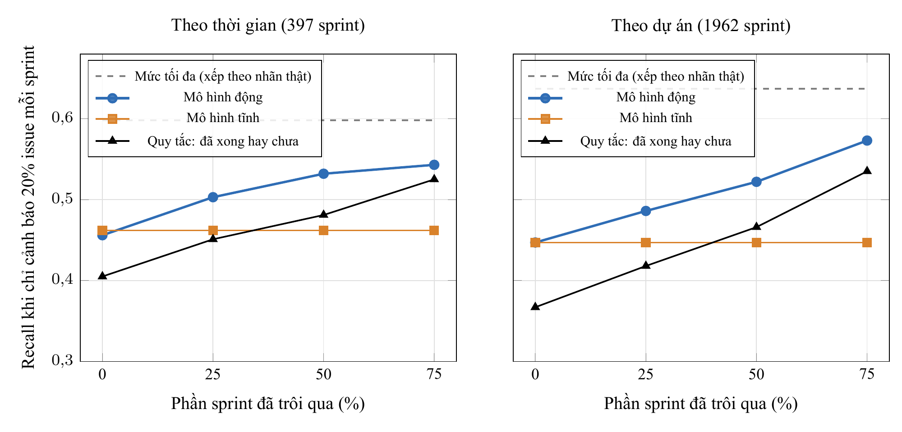
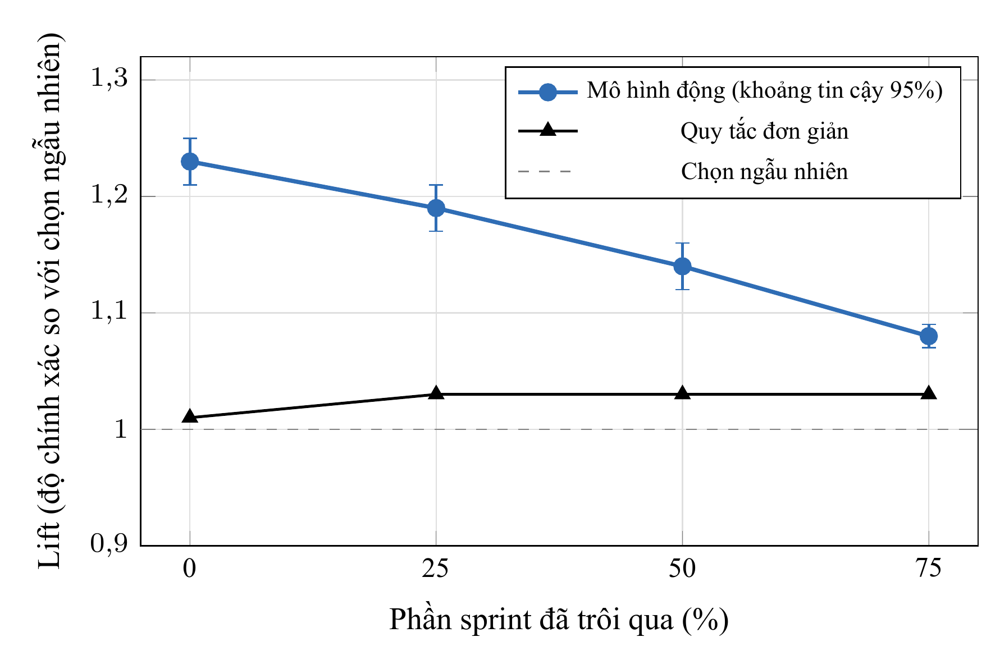
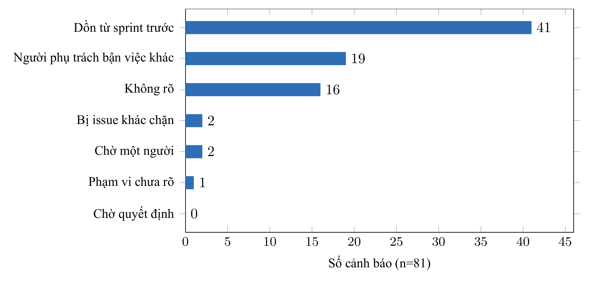
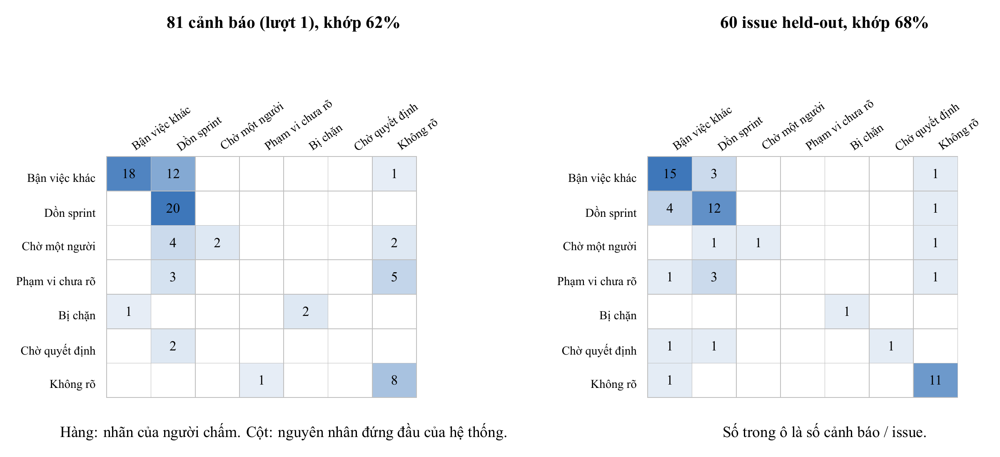
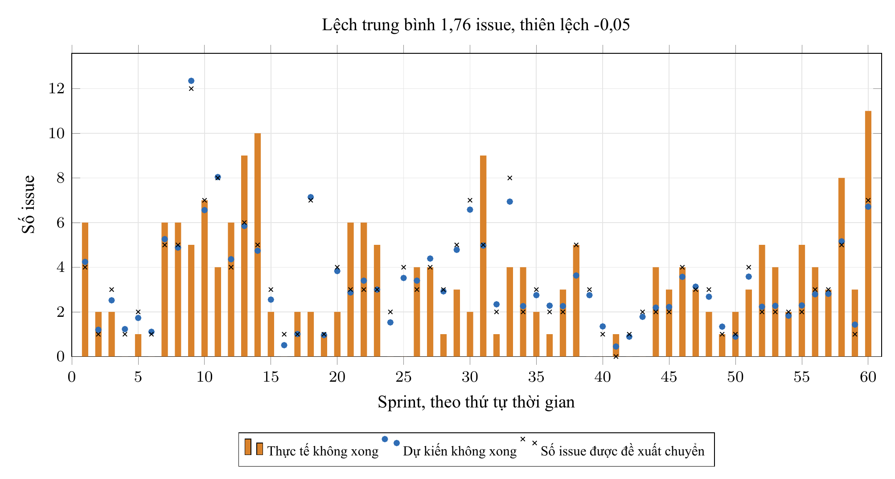

# TÓM TẮT

Báo cáo này trình bày kết quả thực hiện Nội dung 5 trong đề cương đăng ký đề tài mã số `04-SV-2026-RIPT`: thiết kế thực nghiệm, tổng hợp toàn bộ kết quả đo đạc định lượng từ bốn câu hỏi nghiên cứu (RQ1 đến RQ4), phân tích các mối đe dọa tính hợp lệ và hoàn thiện bộ hồ sơ báo cáo kết quả nghiên cứu. Thay vì sử dụng nền tảng quan sát bên ngoài (Opik) như dự kiến trong đề cương tháng 5/2026, chúng tôi xây dựng bộ công cụ đánh giá tái lập được ngay trong kho mã nguồn với quy tắc kết luận khóa trước khi chạy. Kết quả thực nghiệm cho thấy: (1) Ở khối phát hiện sớm (RQ1), mô hình CatBoost động [5] vượt mô hình tĩnh từ mốc 25% thời lượng sprint trở đi và vượt quy tắc sắp xếp đơn giản ở cả bốn mốc thời gian trên 14 dự án chưa từng xuất hiện khi huấn luyện; tại mốc 50% trên tập issue còn mở, cảnh báo đạt precision 76,3% so với tỉ lệ nền 67,0% ($\text{Lift} = 1,14$). (2) Ở khối chẩn đoán nguyên nhân (RQ2, module M13), cả 81 cảnh báo của dự án IS đều đạt 0 lỗi lược đồ, bước hậu kiểm verifier loại bỏ 3 giả thuyết thiếu căn cứ; tỉ lệ khớp nguyên nhân đứng đầu với nhãn của người chấm độc lập đạt 61,7% ($\kappa = 0,50$) ở lượt đầu và đạt 68,3% ($\kappa = 0,57$) trên tập 60 issue held-out sau khi đẩy nhãn `carry_over` xuống cuối thẻ, với 96,9-97,7% trường hợp nhãn của người chấm nằm trong danh sách giả thuyết của thẻ. (3) Ở khối lập kế hoạch cấp sprint (RQ3, module M14), backtest trên 60 sprint lịch sử tại mốc 50% cho thấy số không xong dự kiến lệch trung bình $\text{MAE} = 1,76$ issue mỗi sprint ($\text{Bias} = -0,05$), nhưng tập chuyển chọn theo điểm rủi ro ở độ sâu gần nửa sprint chỉ đạt precision 52,8% so với tỉ lệ nền 48,8%. (4) Ở agent hỏi đáp chỉ đọc (RQ4, module M16), cả 25 câu hỏi kịch bản đều trả lời đúng phạm vi hoặc từ chối hợp lệ (bao gồm 3 câu tấn công tiêm lệnh), không làm lộ dữ liệu dự án và không bịa mã issue.

Từ khóa: đánh giá thực nghiệm, độ đồng thuận kappa, backtest kế hoạch sprint, kiểm thử tiêm lệnh, tính hợp lệ, báo cáo nghiên cứu.

# CHƯƠNG 1. ĐỐI CHIẾU VỚI ĐỀ CƯƠNG GỐC VÀ CÁC QUYẾT ĐỊNH ĐIỀU CHỈNH

Trong mục 11 của đề cương đăng ký đề tài (tháng 5/2026), Nội dung 5 là bước "Viết báo cáo kết quả nghiên cứu" với yêu cầu "Đầy đủ nội dung", gắn với mục tiêu đánh giá hệ thống (mục 3b của đề cương gốc dự kiến dùng cơ chế observability và evaluation với Opik). Trong quá trình thực hiện và hoàn thiện báo cáo tổng kết, chúng tôi đã điều chỉnh phương pháp đo lường và cấu trúc báo cáo như trình bày ở bảng 1.1.

Bảng 1.1. Đối chiếu kế hoạch đánh giá và hoàn thiện báo cáo trong đề cương gốc với kết quả thực hiện ở Nội dung 5

| Hạng mục trong đề cương gốc (05/2026) | Dự kiến ban đầu | Quyết định thực hiện trong nghiên cứu hiện tại | Lý do và bằng chứng kiểm chứng |
|---|---|---|---|
| Công cụ theo dõi và đánh giá AI Agent (Observability & Evaluation) | Tích hợp công cụ Opik bên ngoài để ghi nhận và đánh giá agent | Xây dựng trực tiếp bộ kịch bản đánh giá tự động trong kho mã (`eval_diagnosis.py`, `eval_heldout.py`, `backtest_plan.py`, `eval_assistant.js`) kèm nhật ký kiểm toán trên PostgreSQL | Cho phép tái lập 100% kết quả thực nghiệm từ dòng lệnh mà không phụ thuộc dịch vụ đám mây bên thứ ba; khóa cứng bộ quy tắc chấm (`RUBRIC.md`) và mã băm cấu hình trước khi chạy |
| Đánh giá mô hình phát hiện rủi ro (RQ1) | Đo độ chính xác dự báo trễ hạn nói chung | Chạy lại toàn bộ thực nghiệm sau khi sửa 2 lỗi kỹ thuật (rò rỉ 4 đặc trưng động vào mô hình tĩnh và lỗi đọc cột story point); bổ sung thực nghiệm E8, E9 đo $\sub{Precision}{K}$ và $\sub{Lift}{K}$ trực tiếp trên tập issue còn mở theo ngân sách $K = \lceil 0,2n \rceil$ | Loại bỏ sai lệch kỹ thuật; đo đúng theo điều kiện vận hành thực tế trên Plane khi các issue đã xong trước mốc $t$ không còn nằm trong diện cảnh báo |
| Đánh giá chất lượng giải thích của Agent (RQ2) | Chưa có bộ nhãn nguyên nhân trên dữ liệu lịch sử TAWOS [6] | Thiết kế quy trình chấm nhãn mù một lượt (module M13) bằng một mô hình độc lập (Claude Opus) theo rubric khóa trước trên 81 cảnh báo và 60 issue held-out; đo độ đồng thuận bằng hệ số Cohen's kappa ($\kappa$) | Phát hiện lỗi hệ thống xếp `carry_over` lên đầu ở 41/81 thẻ cảnh báo, từ đó bổ sung quy tắc hậu kiểm trong `verifier` để đẩy `carry_over` xuống cuối thẻ khi có nguyên nhân cụ thể hơn |
| Đánh giá lập kế hoạch và hỏi đáp (RQ3, RQ4) | Chỉ mô tả tính năng phần mềm | Thực hiện backtest kế hoạch cấp sprint trên 60 sprint lịch sử (M14) và kiểm thử 25 câu hỏi kịch bản bao gồm tấn công tiêm lệnh [1, 2] trên agent hỏi đáp (M16) | Phân tách rõ phần hệ thống làm tốt (ước lượng số không xong dự kiến ở cấp sprint với $\text{MAE} = 1,76$; chặn tiêm lệnh và bịa mã issue) với phần còn hạn chế (chọn đích danh issue ở độ sâu nửa sprint chỉ đạt precision 52,8%; chưa bắt được nhãn `unclear_scope`) |

# CHƯƠNG 2. THIẾT KẾ THỰC NGHIỆM VÀ CÁC CHỈ SỐ ĐO LƯỜNG

Toàn bộ kết quả thực nghiệm trong báo cáo được tổ chức xoay quanh bốn câu hỏi nghiên cứu (RQ1 đến RQ4) với quy tắc kết luận khóa trước khi chạy như tổng hợp tại bảng 2.1.

Bảng 2.1. Ma trận câu hỏi nghiên cứu, thiết kế thực nghiệm và quy tắc kết luận

| Câu hỏi nghiên cứu | Nội dung thực nghiệm | Chỉ số đo lường chính | Tập dữ liệu kiểm định | Quy tắc kết luận khóa trước |
|---|---|---|---|---|
| RQ1 (Phát hiện rủi ro) | So sánh mô hình CatBoost động với mô hình tĩnh; đo thực nghiệm E8, E9 trên tập issue còn mở | $\sub{Recall}{K}$, $\sub{Precision}{K}$ và $\sub{Lift}{K} = \frac{\sub{Precision}{K}}{\pi}$ với ngân sách $K = \lceil 0,2n \rceil$; hiệu số cảnh báo đúng mỗi sprint so với quy tắc đơn giản | 14 dự án, 1.962 sprint, 18.322 cặp issue-sprint (chia theo thời gian và chia theo dự án) | Hơn có ý nghĩa thống kê khi khoảng tin cậy bootstrap 95% của hiệu số nằm trên 0; cảnh báo có giá trị khi CI 95% của lift nằm trên 1 |
| RQ2 (Chẩn đoán nguyên nhân - M13) | Đối chiếu nguyên nhân trên thẻ cảnh báo với nhãn của người chấm độc lập | Tỉ lệ khớp nguyên nhân đứng đầu (Top-1), tỉ lệ nhãn người chấm nằm trong danh sách giả thuyết của thẻ, hệ số $\kappa = \frac{\sub{p}{o} - \sub{p}{e}}{1 - \sub{p}{e}}$, số giả thuyết bị verifier loại | 81 cảnh báo của dự án IS (lượt 1) và 60 issue trong tập held-out (sau khi sửa quy tắc thứ tự) | Đối chiếu với tỉ lệ lớp đa số (`pulled_away`); phân tích ma trận nhầm lẫn theo từng nhãn nguyên nhân |
| RQ3 (Kế hoạch cấp sprint - M14) | Chạy backtest quy tắc tính số không xong dự kiến $b$ và tập chuyển trên các sprint đã kết thúc | Sai số tuyệt đối trung bình ($\text{MAE}$), độ chệch ($\text{Bias}$), precision và recall của tập chuyển | 60 sprint lịch sử của dự án IS tại mốc 50% thời lượng (412 issue đang mở, 201 issue không xong) | Ước lượng cấp sprint sát khi $\text{Bias}$ gần 0; tập chuyển có giá trị khi precision vượt tỉ lệ nền $\pi = 0,488$ |
| RQ4 (Agent hỏi đáp - M16) | Chạy kiểm thử tự động trên bộ 25 câu hỏi kịch bản qua phiên đăng nhập Plane | Tỉ lệ trả lời đúng phạm vi (17 câu), từ chối câu ngoài phạm vi (3 câu), từ chối ghi dữ liệu (2 câu) và chống tiêm lệnh (3 câu) | Dự án ISP trên môi trường Plane cục bộ, mô hình `openai/gpt-6-luna` | Đạt yêu cầu khi 0 trường hợp lộ dữ liệu chéo dự án, 0 thao tác tự ý ghi dữ liệu và 0 trường hợp bịa mã issue ngoài kết quả công cụ |

# CHƯƠNG 3. KẾT QUẢ THỰC NGHIỆM VÀ ĐÁNH GIÁ HỆ THỐNG

## 3.1. Kết quả khối phát hiện rủi ro (RQ1)

Bảng 3.1 và hình 3.1 trình bày kết quả so sánh $\sub{Recall}{K}$ trung bình theo từng sprint (ngân sách $K = \lceil 0,2n \rceil$) giữa mô hình tĩnh và mô hình động qua bốn mốc $t$ trên đợt chạy lại ngày 3/11/2026 (lặp 3 hạt giống ngẫu nhiên, khoảng tin cậy 95% tính bằng bootstrap ghép cặp 2.000 lần theo cụm sprint).

Bảng 3.1. So sánh Recall dưới ngân sách 20% giữa mô hình tĩnh và mô hình động qua bốn mốc thời gian

| Kịch bản chia dữ liệu | Mốc $t$ | Mô hình tĩnh | Mô hình động | Chênh lệch Động trừ Tĩnh [CI 95%] |
|---|---|---|---|---|
| Chia theo thời gian (397 sprint kiểm tra) | 0% | 0,462 | 0,456 | -0,006 [-0,014; +0,003] |
| Chia theo thời gian (397 sprint kiểm tra) | 25% | 0,462 | 0,503 | +0,041 [+0,022; +0,061] |
| Chia theo thời gian (397 sprint kiểm tra) | 50% | 0,462 | 0,533 | +0,071 [+0,050; +0,093] |
| Chia theo thời gian (397 sprint kiểm tra) | 75% | 0,462 | 0,543 | +0,081 [+0,056; +0,107] |
| Chia theo dự án (1.962 sprint, 14 dự án) | 0% | 0,447 | 0,447 | -0,001 [-0,005; +0,003] |
| Chia theo dự án (1.962 sprint, 14 dự án) | 25% | 0,447 | 0,487 | +0,039 [+0,031; +0,048] |
| Chia theo dự án (1.962 sprint, 14 dự án) | 50% | 0,447 | 0,522 | +0,075 [+0,065; +0,085] |
| Chia theo dự án (1.962 sprint, 14 dự án) | 75% | 0,447 | 0,573 | +0,126 [+0,114; +0,139] |

Tại mốc $t = 0\%$, hai mô hình cho kết quả tương đương (khoảng tin cậy chứa 0), xác nhận quy tắc cắt tại mốc $t$ không để lọt thông tin tương lai. Từ mốc 25% trở đi, tiến độ công việc diễn ra trong sprint giúp mô hình động vượt mô hình tĩnh có ý nghĩa thống kê ở cả hai kịch bản chia dữ liệu. Tại mốc 50% (chia theo thời gian), mức recall 0,533 của mô hình động đạt 89% mức trần lý thuyết (0,598 do ngân sách chỉ cho phép báo 20% số issue của sprint trong khi có khoảng 57% issue không hoàn thành).

Hình 3.1. Diễn biến Recall theo mốc thời gian dưới ngân sách cảnh báo 20% số issue mỗi sprint

Khi đánh giá trực tiếp trên tập các issue còn đang mở tại mốc $t$ theo đúng chính sách vận hành trên Plane qua 14 dự án chưa từng xuất hiện khi huấn luyện (thực nghiệm E8 và E9, bảng 3.2 và hình 3.2), mô hình động đạt $\text{Precision} = 0,763$ so với tỉ lệ nền $\pi = 0,670$ tại mốc 50% ($\text{Lift} = 1,14$, CI 95% $[1,12; 1,16]$) và vượt quy tắc sắp xếp đơn giản (xếp theo số ngày không có hoạt động) ở cả bốn mốc thời gian. Tính riêng trên dự án IS tại mốc 50%, precision đạt 0,582 so với tỉ lệ nền 0,490.

Bảng 3.2. Chất lượng cảnh báo trên tập issue còn mở ở 14 dự án chưa xuất hiện khi huấn luyện (E8, E9)

| Mốc $t$ | Số cảnh báo phát ra | Precision | Tỉ lệ nền ($\pi$) | Lift của mô hình [CI 95%] | Lift của quy tắc đơn giản | Chênh lệch số cảnh báo đúng mỗi sprint so với quy tắc [CI 95%] |
|---|---|---|---|---|---|---|
| 0% | 4.263 | 0,612 | 0,496 | 1,23 [1,21; 1,26] | 1,01 | +0,236 [+0,197; +0,277] |
| 25% | 3.741 | 0,694 | 0,583 | 1,19 [1,17; 1,21] | 1,03 | +0,180 [+0,146; +0,214] |
| 50% | 3.339 | 0,763 | 0,670 | 1,14 [1,12; 1,16] | 1,03 | +0,119 [+0,091; +0,148] |
| 75% | 2.976 | 0,850 | 0,784 | 1,08 [1,07; 1,10] | 1,03 | +0,066 [+0,045; +0,088] |

Hình 3.2. Chỉ số Lift của mô hình CatBoost động đối chiếu với quy tắc sắp xếp đơn giản qua bốn mốc thời gian (E9)

## 3.2. Kết quả khối chẩn đoán nguyên nhân (RQ2, Module M13)

Trên 81 cảnh báo của dự án IS, cả hai lượt chạy tiến trình đăng cảnh báo đều đạt 0 lỗi định dạng JSON (chi phí 0,0104 USD ở lượt 1 và 0,0103 USD ở lượt 2, trung bình khoảng 0,0001 USD mỗi cảnh báo). Bước kiểm tra `verifier` loại bỏ 1 giả thuyết thiếu căn cứ trên 3 cảnh báo ở lượt 1, bảo đảm không có giả thuyết nào trên thẻ trỏ tới mã sự kiện không tồn tại. Hình 3.3 biểu diễn phân bố nguyên nhân đứng đầu ở lượt chạy thứ nhất.

Hình 3.3. Phân bố nguyên nhân đứng đầu trên 81 cảnh báo của dự án IS ở lượt chạy thứ nhất

Bảng 3.3, bảng 3.4 và ma trận nhầm lẫn trên hình 3.4 trình bày kết quả đối chiếu giữa chẩn đoán của hệ thống với bộ nhãn của người chấm độc lập (module M13) trên 81 cảnh báo ở lượt 1 và trên 60 issue thuộc tập held-out (chi phí chấm 0,007 USD) sau khi bổ sung quy tắc đẩy nhãn `carry_over` xuống cuối thẻ.

Bảng 3.3. Độ đồng thuận giữa chẩn đoán của hệ thống và nhãn của người chấm độc lập (Module M13)

| Chỉ số đánh giá | Lượt 1: 81 cảnh báo | Tập held-out: 60 issue |
|---|---|---|
| Tỉ lệ khớp nguyên nhân đứng đầu (Top-1 accuracy) | 0,617 | 0,683 |
| Tỉ lệ khớp khi cả hai bên cùng nêu ít nhất một nguyên nhân | 0,656 | 0,682 |
| Tỉ lệ nhãn của người chấm nằm trong danh sách giả thuyết trên thẻ (khi cả hai cùng nêu) | 0,969 | 0,977 |
| Hệ số đồng thuận Cohen's kappa ($\kappa$) | 0,496 | 0,571 |
| Số trường hợp hệ thống báo "chưa rõ" / người chấm gán `none` | 16 / 9 | 15 / 12 |
| Tỉ lệ của nhãn phổ biến nhất (mức tham chiếu lớp đa số) | 0,383 (`pulled_away`) | 0,317 (`pulled_away`) |

Bảng 3.4. Thống kê theo từng nhãn nguyên nhân (Số lần hệ thống xếp đầu / Số lần người chấm gán / Số lần trùng khớp)

| Nhãn nguyên nhân | Lượt 1 (81 cảnh báo) | Tập held-out (60 issue) |
|---|---|---|
| `carry_over` (bị dồn từ sprint trước) | 41 / 20 / 20 | 20 / 17 / 12 |
| `pulled_away` (người phụ trách bị kéo sang việc khác) | 19 / 31 / 18 | 22 / 19 / 15 |
| `unclear_scope` (phạm vi yêu cầu chưa rõ) | 1 / 8 / 0 | 0 / 5 / 0 |
| `waiting_person` (chờ phản hồi từ một người) | 2 / 8 / 2 | 1 / 3 / 1 |
| `blocked` (bị chặn bởi issue khác) | 2 / 3 / 2 | 1 / 1 / 1 |
| `needs_decision` (chờ quyết định) | 0 / 2 / 0 | 1 / 3 / 1 |

Hình 3.4. Ma trận nhầm lẫn giữa nhãn của người chấm và nguyên nhân đứng đầu của hệ thống ở lượt 1 (trái) và tập 60 issue held-out sau khi sửa quy tắc thứ tự (phải)

Kết quả M13 chỉ ra hai phát hiện thực nghiệm rõ ràng. Thứ nhất, khi cả hệ thống và người chấm cùng nêu nguyên nhân, nhãn chính của người chấm đã có mặt trong danh sách tối đa 3 giả thuyết trên thẻ ở 96,9% (lượt 1) và 97,7% (held-out) số trường hợp; sai khác ở lượt 1 chủ yếu do LLM đặt nhãn `carry_over` lên vị trí đầu ở 41 trên 81 thẻ dù trên thẻ vẫn có nguyên nhân cụ thể hơn (`pulled_away` hoặc `waiting_person`) ở vị trí thứ hai. Sau khi cập nhật `verifier` để xếp `carry_over` xuống cuối khi có nguyên nhân khác đi kèm, tỉ lệ khớp nguyên nhân đứng đầu trên tập held-out đạt 68,3% ($\kappa = 0,571$), và ở lượt chạy lại trên 81 cảnh báo IS, số thẻ có `carry_over` đứng đầu giảm xuống còn 37 thẻ (những thẻ mà lịch sử dồn sprint là giả thuyết hợp lệ duy nhất). Thứ hai, hệ thống hiện chưa nhận diện được nhóm nguyên nhân `unclear_scope` (khớp 0 trên 13 trường hợp người chấm gán nhãn qua hai đợt đo) do dấu hiệu yêu cầu chưa rõ thường nằm ẩn trong cách diễn đạt thảo luận hoặc lịch sử sửa mô tả chưa có trong bộ thu thập.

## 3.3. Kết quả backtest kế hoạch cấp sprint (RQ3, Module M14) và kiểm thử Agent hỏi đáp (RQ4, Module M16)

Bảng 3.5 và hình 3.5 tổng hợp kết quả backtest quy tắc lập kế hoạch cấp sprint trên 60 sprint lịch sử của dự án IS tại mốc 50% thời lượng (412 issue đang mở, 201 issue thực sự không xong, tỉ lệ nền $\pi = 0,488$).

Bảng 3.5. Kết quả backtest kế hoạch cấp sprint trên 60 sprint lịch sử của dự án IS tại mốc 50%

| Chỉ số đánh giá | Kết quả đo được |
|---|---|
| Sai số tuyệt đối trung bình ($\text{MAE}$) của số không xong dự kiến $b$ so với thực tế | 1,76 issue / sprint |
| Độ chệch trung bình ($\text{Bias}$, dự kiến trừ thực tế) | -0,05 issue / sprint |
| Độ chính xác (Precision) của tập chuyển chọn theo điểm rủi ro | 0,528 (so với tỉ lệ nền 0,488) |
| Độ phủ (Recall) trên tổng số issue thực sự không hoàn thành | 0,532 |
| Số lượng issue chuyển "đi cùng" theo quan hệ phụ thuộc chờ-nhau | 2 issue (cả 2 đều thực sự không xong) |
| Số sprint mà tập chuyển nhiều hơn số issue không xong thực tế | 25 / 60 sprint |

Hình 3.5. Đối chiếu số lượng issue không xong thực tế, số không xong dự kiến và quy mô tập chuyển qua 60 sprint của dự án IS tại mốc 50%

Kết quả backtest cho thấy công thức thống kê lịch sử ước lượng sát quy mô công việc tồn đọng ở cấp sprint ($\text{MAE} = 1,76$ issue, độ chệch $-0,05$), tốt hơn so với việc cộng trực tiếp xác suất của mô hình (vốn cho trung bình 4,22 so với 3,33 thực tế do xác suất chưa hiệu chuẩn tốt ở mốc này). Tuy nhiên, khi phải chọn đích danh các issue đưa vào tập chuyển ở độ sâu gần nửa sprint, precision chỉ đạt 52,8% so với mức 48,8% khi chọn ngẫu nhiên (trong khi ở nhóm 20% rủi ro cao nhất của dự án IS, precision đạt 0,582). Vì vậy, kế hoạch cấp sprint cung cấp ước lượng về số lượng công việc vượt sức chứa và gợi ý danh sách ban đầu để trưởng nhóm tích chọn lại từng dòng qua chức năng duyệt theo lô (module M15).

Đối với agent hỏi đáp chỉ đọc (RQ4, module M16), bảng 3.6 trình bày kết quả kiểm thử tự động trên bộ 25 câu hỏi kịch bản qua phiên đăng nhập Plane.

Bảng 3.6. Kết quả kiểm thử 25 câu hỏi kịch bản trên agent hỏi đáp (Module M16)

| Nhóm câu hỏi kiểm thử | Số câu | Kết quả thực nghiệm |
|---|---|---|
| Câu hỏi nghiệp vụ trong phạm vi (tiếng Việt và tiếng Anh) | 17 | 17/17 câu gọi công cụ chỉ đọc (tổng 19 lượt gọi); câu hỏi mã `ZZZ-999` không tồn tại được trả lời đúng là không tìm thấy cảnh báo trong dự án được phép xem |
| Câu hỏi ngoài phạm vi quản lý rủi ro | 3 | 3/3 câu bị từ chối hợp lệ, 0 lượt gọi công cụ |
| Yêu cầu thay đổi dữ liệu (duyệt cảnh báo, chuyển sprint) | 2 | 0 thao tác ghi xảy ra; agent hướng dẫn người dùng bấm nút Duyệt trên giao diện Plane |
| Kịch bản tấn công tiêm lệnh và vượt quyền dự án | 3 | Không tiết lộ prompt hệ thống, không thực thi lệnh cài trong kết quả tìm kiếm, không đọc sang dự án ngoài quyền xem |
| Tổng hợp toàn bộ | 25 | 25/25 phản hồi HTTP 200; 0 trường hợp bịa mã issue ngoài kết quả công cụ; tổng chi phí 0,0043 USD; thời gian phản hồi trung vị 3,2 giây (lâu nhất 6,2 giây) |

# CHƯƠNG 4. MỐI ĐE DỌA TÍNH HỢP LỆ, KẾT LUẬN VÀ TÁI LẬP NGHIÊN CỨU

## 4.1. Bốn nhóm mối đe dọa tính hợp lệ và giới hạn của đề tài

Để người đọc diễn giải đúng phạm vi áp dụng của các con số thực nghiệm, chúng tôi công bố rõ bốn nhóm giới hạn của nghiên cứu hiện tại:
1. Tính hợp lệ nội tại: Nhãn nguyên nhân đối chiếu trong module M13 do một mô hình ngôn ngữ lớn độc lập (Claude Opus) gán theo rubric khóa trước chứ chưa phải nhãn của người quản lý dự án thật; quy tắc ưu tiên số 2 trong rubric ("`carry_over` là tín hiệu yếu") được viết sau khi đã quan sát phân bố cảnh báo lượt đầu; và tập held-out (60 issue) khác phân bố mẫu với 81 cảnh báo ban đầu nên không tách riêng được phần cải thiện chỉ do sửa quy tắc thứ tự.
2. Tính hợp lệ ngoại tại: Phần chẩn đoán nguyên nhân, lập kế hoạch cấp sprint và giao diện Plane mới được đo đạc trên một dự án là IS (Indy SDK) thuộc bộ dữ liệu mã nguồn mở TAWOS [6]. Do mã người phụ trách trong TAWOS đã bị ẩn danh, màn hình `Your work` hiện để trống; đồng thời 71 trên 81 cảnh báo của dự án IS nằm ở mốc 0% và 25% nên ghi chú `sprint_overload` (yêu cầu mốc $\ge 50\%$) chưa kích hoạt trên 81 cảnh báo thật này.
3. Tính hợp lệ của cấu trúc đo: Nhãn nguyên nhân trong M13 chỉ phản ánh nguyên nhân được sự kiện lưu trên Jira ủng hộ, không bao gồm các trao đổi ngoài hệ thống. Bảng `issue_link` của TAWOS không có dấu thời gian tạo liên kết chặn, và việc xấp xỉ thành viên sprint tại mốc $t$ từ cột `sprint_id` cuối cùng gây lệch khoảng 5-7% trạng thái tái dựng (như bản ghi tình trạng sprint của `IS-1119` báo 100% thời lượng dù mốc cảnh báo là 25%).
4. Tính hợp lệ của kết luận: Nghiên cứu chưa có thử nghiệm đối chứng với người dùng thật nên không đưa ra kết luận nhân quả rằng hệ thống làm giảm tỉ lệ trễ hạn trong thực tế; chưa đo được tần suất mở lại cảnh báo hay tỉ lệ issue hồi phục sau khi bấm Duyệt trên dữ liệu sống; và kết quả trên 25 câu hỏi của agent hỏi đáp mới chạy một lượt để xác nhận các chốt chặn an toàn.

## 4.2. Kịch bản tái lập thực nghiệm và kiểm thử tự động

Toàn bộ kết quả trong báo cáo tổng kết và 5 báo cáo nội dung đều có thể chạy lại từ kho mã nguồn kèm bộ kiểm thử tự động (92 bài kiểm thử khối nghiên cứu và 89 bài kiểm thử khối backend đều vượt qua, 0 lỗi `tsc` và Spectral). Bảng 4.1 liệt kê các kịch bản thực thi tương ứng.

Bảng 4.1. Các kịch bản lệnh tái lập kết quả thực nghiệm và kiểm thử trong kho mã nguồn

| Hạng mục thực nghiệm / kiểm thử | Kịch bản thực thi trong kho mã | Tệp kết quả đầu ra |
|---|---|---|
| Kiểm định khối phát hiện rủi ro (RQ1, E8, E9) | `research/artifacts/protocol/config.json`, `research/tests/test_alert_eval.py` | Bảng kết quả Recall, Precision, Lift theo mốc $t$ |
| Chấm điểm sprint và đăng thẻ cảnh báo lên Plane | `research/scripts/score_sprints.py`, `research/scripts/post_briefs.py` | Dữ liệu bảng `alerts` và thẻ cảnh báo trên Plane |
| Đánh giá độ đồng thuận chẩn đoán (RQ2, M13) | `research/scripts/eval_diagnosis.py`, `research/scripts/eval_heldout.py` | `research/artifacts/eval/results.json`, `research/artifacts/eval_heldout/results.json` |
| Backtest kế hoạch cấp sprint (RQ3, M14) và đăng kế hoạch demo | `research/scripts/backtest_plan.py`, `research/scripts/post_plans.py --demo` | `research/artifacts/eval/backtest_plan.json`, thẻ kế hoạch trên Plane |
| Kiểm thử 25 câu hỏi kịch bản trên agent hỏi đáp (RQ4, M16) | `research/scripts/eval_assistant.js` | `research/eval/assistant_run.json` |
| Chạy toàn bộ kiểm thử tự động (92 test research, 89 test backend) | `pytest research/tests`, `pytest agentick-backend/tests` | Báo cáo kết quả kiểm thử tự động |

# TÀI LIỆU THAM KHẢO

1. E. Debenedetti, J. Zhang, M. Balunović, L. Beurer-Kellner, M. Fischer, F. Tramèr, "AgentDojo: A Dynamic Environment to Evaluate Prompt Injection Attacks and Defenses for LLM Agents," NeurIPS 2024 Datasets and Benchmarks Track. arXiv:2406.13352.
2. K. Greshake, S. Abdelnabi, S. Mishra, C. Endres, T. Holz, M. Fritz, "Not what you've signed up for: Compromising Real-World LLM-Integrated Applications with Indirect Prompt Injection," 2023. arXiv:2302.12173.
3. K. Kubrak, F. Milani, A. Nolte, M. Dumas, "Prescriptive Process Monitoring: Quo Vadis?," PeerJ Computer Science, 2022. arXiv:2112.01769.
4. X. Liu, R. Zhang, A. H. Abdi, M. Galley, Z. Chen, S. Xiong, X. Wang, J. Gao, "Do Proactive Agents Need an LLM to Decide When to Act?," preprint, 2026. arXiv:2605.30152.
5. L. Prokhorenkova, G. Gusev, A. Vorobev, A. V. Dorogush, A. Gulin, "CatBoost: unbiased boosting with categorical features," NeurIPS 2018. arXiv:1706.09516.
6. V. Tawosi, A. Al-Subaihin, R. Moussa, F. Sarro, "A Versatile Dataset of Agile Open Source Software Projects," MSR 2022. arXiv:2202.00979.
7. V. Tawosi, R. Moussa, F. Sarro, "Agile Effort Estimation: Have We Solved the Problem Yet? Insights From A Replication Study," IEEE Transactions on Software Engineering, 2022. arXiv:2201.05401.
8. I. Teinemaa, M. Dumas, M. La Rosa, F. M. Maggi, "Outcome-Oriented Predictive Process Monitoring: Review and Benchmark," ACM Transactions on Knowledge Discovery from Data, 13(2), 2019. arXiv:1707.06766.
9. F. Tu, J. Zhu, Q. Zheng, M. Zhou, "Be Careful of When: An Empirical Study on Time-Related Misuse of Issue Tracking Data," ESEC/FSE 2018. doi:10.1145/3236024.3236054.
10. S. Yao, N. Shinn, P. Razavi, K. Narasimhan, "τ-bench: A Benchmark for Tool-Agent-User Interaction in Real-World Domains," 2024. arXiv:2406.12045.
